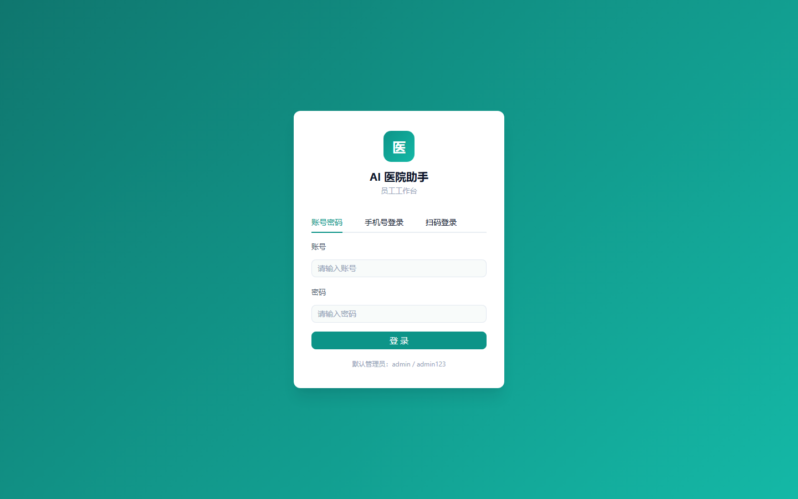
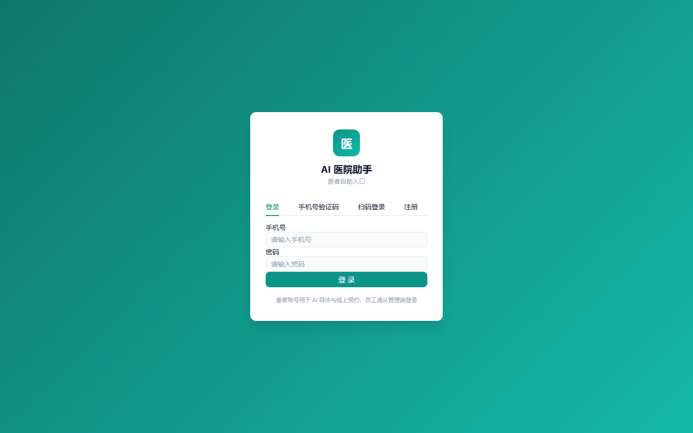
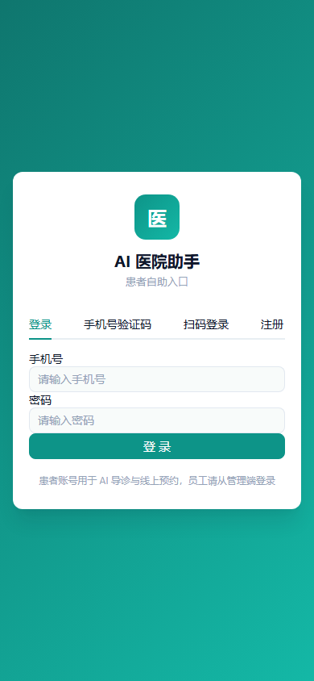
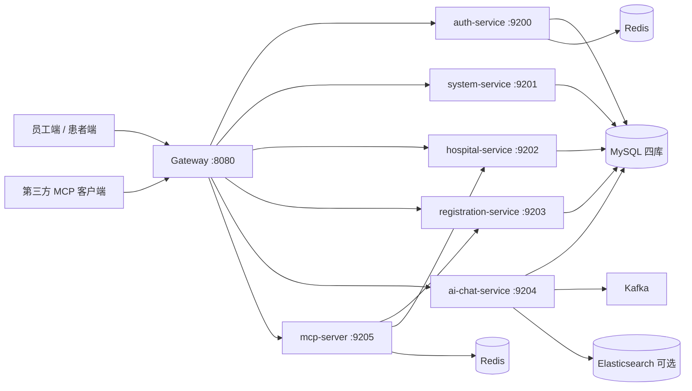

# AI 医院助手（AI Hospital Assistant）

> 基于 **Spring Cloud 微服务 + Spring AI** 的医疗场景 AI 助手平台：聊天 / 导诊 / 智能挂号 / 知识库问答，同时内置完整的医院业务与 RBAC 权限体系。
>
> A microservice-based AI hospital assistant built with Spring Cloud, Spring AI and Vue 3 — chat, triage, smart registration and RAG Q&A.


[](https://github.com/yh230/ai-assistant/actions/workflows/ci.yml)
[](LICENSE)

## 这是什么

一个**学习 / 展示用途**的完整案例：把「Spring Cloud 微服务实践」与「大模型应用落地（Tool Calling / RAG / SSE 流式）」放进同一套可运行的医院业务系统。员工端与管理端面向医院员工，患者端面向患者账号。

> AI 输出仅辅助参考，**不提供诊断与处方**；产品层强制附带免责文案，并内置输入/输出双向风控。

## 核心能力

| 能力 | 入口 | 技术看点 |
|------|------|----------|
| AI 导诊 | 患者端 | 真实科室 Tool Calling、急症红线、免责兜底 |
| 智能挂号 | 患者端 | 写工具 + 二次确认状态机 + 租户校验 |
| RAG 知识库 | 患者端 / 管理端 | 结构切片、混合检索、引用与 groundedness |
| 员工聊天 | 员工端 | 人设库、模型故障转移、token 预算与摘要 |
| 医院业务 | 管理端 | 多医院数据隔离、排班号源、预约状态机 |
| 工程底座 | 全链路 | 双身份 JWT、网关限流、Kafka、可观测性 |

## 界面预览

<p align="center">
  
  
</p>
<p align="center">
  
</p>

> 登录页支持账号密码、手机号验证码与扫码三种方式；核心业务页面截图欢迎通过 PR 补充。

## 快速体验

Windows：

```bat
mysql -uroot -p < sql/init.sql
scripts\start-nacos.bat
scripts\start-services.bat
```

macOS / Linux：

```bash
mysql -uroot -p < sql/init.sql
scripts/start-nacos.sh
scripts/start-services.sh
```

前端：`cd ai-assistant-frontend && npm ci && npm run dev`，访问 `http://localhost:5173`（员工端）或 `http://localhost:5173/patient/login`（患者端）。

> 完整环境要求、Nacos 配置与密钥设置见下方 [快速开始](#快速开始)。

## 架构一览



> 详细服务边界、数据归属与调用链见 [架构说明](docs/design/architecture.md)。

## 文档

- [架构说明](docs/design/architecture.md)
- [阅读路线](docs/design/reading-guide.md)
- [AI 评测](docs/design/evaluation.md)
- [E2E 套件](ai-assistant-e2e/README.md)
- [安全策略](SECURITY.md)
- [贡献指南](CONTRIBUTING.md)
- [MCP 排班查询设计](docs/design/mcp-schedule-design.md)

## 功能明细

**AI 能力**

- 智能聊天：SSE 逐 token 流式输出、多会话管理、Markdown 渲染；Tool Calling 对话中直接查真实天气
- AI 导诊：基于候诊描述的科室推荐（真实科室数据，不编造）；可衔接号源查询
- AI 智能挂号：工具调用 + **二次确认状态机**（pending_action 表 + SSE `confirm_required` 事件），确认/取消/超时全链路
- 轻量 RAG 知识库：管理员上传 md/txt（≤2MB）自动切片与向量化（本地 ONNX 嵌入模型），问答按医院隔离检索
- 引用来源与急症红线：RAG 回答附参考来源；急症症状自动引导急诊
- 安全底座：输入风控（敏感词直接拦截、不调模型）、输出风控、SSE 加固、限流（网关令牌桶）
- 双身份体系：员工（STAFF）与患者（PATIENT）JWT 身份隔离，患者账号绑定医院、数据按医院边界隔离
- 对外 MCP：第三方 AI 客户端凭 API Key 查询绑定医院的未来 14 天排班与真实余量（只读、按院隔离、Key 级限流）

**业务模块**

- 医院人员与出勤：多医院 / 多科室、按【医院-科室-角色】三级数据隔离、出勤多维统计
- 门诊挂号：排班号源、预约取号、退号就诊、多维度统计（含公开的患者预约入口）
- RBAC 员工权限：Spring Security + JWT（双令牌续期）+ 角色/菜单/按钮权限、个人中心、踢下线
- 安全加固：登录失败锁定（默认 5 次锁 15 分钟）、公开接口限流、关键操作审计（`sys_oper_log`）
- 可观测性：全链路追踪（Zipkin）+ Prometheus 指标 + traceId 日志
- Kafka 异步解耦：站内信通知 / 审计落库 / 知识库异步向量化（幂等消费 + 死信队列）

## 系统架构

```text
┌──────────────┐        ┌───────────────────────────────┐
│ 前端 Vue 3    │  HTTP  │ 网关 gateway :8080            │
│ dev :5173    │ ─────▶ │ 统一鉴权 · 身份隔离 · 限流      │
└──────────────┘        └───────────────┬───────────────┘
                                        │ 路由转发（Nacos 服务发现）
      ┌──────────────┬──────────────┬───┴──────────┬──────────────────┐
      ▼              ▼              ▼              ▼                  ▼
 auth-service  system-service  hospital-service  registration-service  ai-chat-service
   :9200          :9201            :9202              :9203              :9204
 登录/令牌       用户/RBAC       医院/出勤/科室     排班/号源/挂号    聊天/AI 导诊/RAG
      └──────────────┴──────────────┴──────────────┴──────────────────┘
                                        │
       ┌───────────┬────────────────────┴────────────┬──────────────┐
       ▼           ▼                                 ▼              ▼
   MySQL 8     Redis（≥6.2）                     Nacos 3.x      DeepSeek API
 （四库分治）  登录态/权限快照/限流/令牌白名单    注册+配置中心   （可选，未配置自动本地降级）
```

## 技术栈

| 层级 | 技术 |
|------|------|
| 后端 | Java 17 · Spring Boot 3.5.16 · Spring Cloud（Nacos 注册与配置）· Spring AI 1.0 |
| 鉴权与缓存 | Spring Security 6 + JWT（jjwt 0.12）+ Redis 撤销（登出黑名单 / 踢下线 / refresh 轮换） |
| ORM | MyBatis-Plus 3.5（RBAC / 医院 / 挂号）· Spring Data JPA（chat 模块） |
| 服务间调用 | OpenFeign（`api` 模块，统一内部令牌） |
| 数据 | MySQL 8（四库分治）· Redis（≥ 6.2，刷新令牌消费用 GETDEL） |
| 前端 | Vue 3 + Vite 5 + Element Plus 2.14（按需自动引入）+ 青绿主题（#0D9488）+ vue-router 4 + axios |
| 测试 | JUnit（后端单测）· Python + pytest + httpx（API 级 E2E）|

## 项目结构

```text
aidaima/
├── ai-assistant-backend/     # 后端：父工程 + 10 模块
│   ├── gateway/              # 网关：统一入口、鉴权、路由、限流
│   ├── common/               # 公共：Result/PageResult、异常、数据权限
│   ├── common-security/      # 安全公共组件：JWT、内部调用校验、Security 配置
│   ├── api/                  # 服务间 Feign 接口与 DTO
│   └── services/             # auth / system / hospital / registration / ai-chat / mcp
├── ai-assistant-frontend/    # 前端：Vue 3 + Vite + Element Plus（员工端 + 患者端）
├── ai-assistant-e2e/         # API 级 E2E 自动化测试（Python + pytest + httpx）
├── scripts/                  # 一键脚本：Nacos / 服务 / E2E（含共享配置样例）
```

## 环境要求

| 依赖 | 版本 | 说明 |
|------|------|------|
| JDK | 17 | 自行安装并配置 `JAVA_HOME` |
| Maven | 3.9+（可选） | 仓库自带 Maven Wrapper，优先使用 `./mvnw` / `mvnw.cmd` |
| MySQL | 8 | 需先建好四个库（见快速开始第 1 步） |
| Redis | ≥ 6.2 | 默认 `localhost:6379`（刷新令牌消费用 GETDEL） |
| Node.js | 18+ | 前端构建与开发 |
| Nacos | 3.x | 服务端口 8848，控制台 8849；需设置 `NACOS_HOME`（见快速开始第 2 步） |
| Kafka | 3.x | 站内信、审计落库、知识库异步向量化；未启动时相关异步链路不可用 |
| Elasticsearch | 8.x（可选） | 仅当 `AI_RAG_STORE=elasticsearch` 时启用混合检索；默认 `simple` 本地向量 |
| Python | 3.10+（可选） | 仅运行 `ai-assistant-e2e/` 测试套件时需要 |
| Zipkin | 可选 | 链路追踪 UI；不启动不影响业务 |

## 快速开始

### 1. 初始化数据库

一条命令创建全部四库与全部表（可重复执行）：

```bash
mysql -uroot -p < sql/init.sql
```

`sql/init.sql` 含 `system_db` / `hospital_db` / `registration_db` / `chat_db` 四库的建库与建表；角色/菜单/演示数据由各服务首次启动时自动播种。

> 存量库升级：结构变更已并入 `sql/init.sql`（对已存在表为幂等）。

### 2. 启动 Nacos

先设置 `NACOS_HOME` 指向 Nacos 3.x 安装目录，再运行启动脚本：

```bat
setx NACOS_HOME "D:\tools\nacos"
scripts\start-nacos.bat
```

macOS / Linux：

```bash
export NACOS_HOME=/opt/nacos
scripts/start-nacos.sh
```

控制台 `http://localhost:8849`（首次登录按提示初始化 admin 口令）。

### 3. 创建共享配置

Nacos 控制台「配置管理 → 新建」：dataId `common-shared.yaml`、group `DEFAULT_GROUP`，内容粘贴 `scripts/nacos-common-shared.yaml` 全文（含 JWT 密钥、内部调用令牌、Redis 地址，AI 配置段 `ai.*`：prompt / 免责文案 / 风控词 / RAG 参数 / 限流阈值，以及 `spring.ai.model.embedding: none`）。

### 4. 配置密钥（环境变量）

```bat
setx DB_PASSWORD 你的MySQL密码
setx DEEPSEEK_API_KEY sk-你的大模型Key
setx AMAP_KEY 你的高德Key
```

macOS / Linux：

```bash
export DB_PASSWORD='你的MySQL密码'
export DEEPSEEK_API_KEY='sk-你的大模型Key'
export AMAP_KEY='你的高德Key'
```

设置后重开终端生效；开发机也可直接改各服务 yml 占位符默认值，但不要提交真实密钥。

### 5. 启动后端

Windows 运行 `scripts/start-services.bat`（七个窗口：六业务服务 + 网关）；macOS / Linux 运行 `scripts/start-services.sh`（后台启动，日志在 `ai-assistant-backend/logs/`）。各服务日志出现 `Started` 后进入下一步。

> **ai-chat-service 首次启动**：知识库向量嵌入使用本地 ONNX 模型（`spring-ai-transformers`，all-MiniLM-L6-v2），首次启动会从 GitHub 下载并加载，可能明显变慢（缓存于 `%TEMP%\spring-ai-onnx-generative\`；网络受限时确保代理可用，或改用离线预置：把模型 `.onnx` 放到任意路径，在 Nacos `ai.rag.embedding-model-path` 填完整路径，tokenizer 需与模型同目录且命名为「模型名去 `.onnx` + `-tokenizer.json`」）。未配置 `DEEPSEEK_API_KEY` 时对话自动降级本地回复引擎，不影响启动。
>
> 知识库向量文件目录 `data/vector/`（Nacos `ai.rag.vector-path`，相对服务启动目录，按医院分文件 `hospital_{id}.json`）为运行产物，不随仓库分发，请勿手工编辑。

### 6. 启动前端

```bash
cd ai-assistant-frontend
npm ci
npm run dev
```

访问 `http://localhost:5173`（员工端，代理已指向网关 8080）；患者端入口 `http://localhost:5173/patient/login`。

## 端口一览

| 组件 | 端口 |
|------|------|
| 前端（Vite dev） | 5173 |
| 网关 gateway | 8080 |
| auth-service | 9200 |
| system-service | 9201 |
| hospital-service | 9202 |
| registration-service | 9203 |
| ai-chat-service | 9204 |
| mcp-server | 9205 |
| Nacos | 8848（控制台 8849） |

## 默认账号

- `admin / admin123` —— 首次启动由 system-service 播种，**请尽快修改密码**
- 登录后可在「用户管理」创建员工并分配医院 / 科室 / 角色

## 生产部署安全前置

- **服务端口仅内网**：9200-9205 为 auth/system/hospital/registration/ai-chat/mcp-server 直连端口，生产只暴露网关（8080），并将 9200-9205 限制在内网或容器网络，禁止公网访问（`/inner/**` 仅凭内部令牌保护）。
- **强制覆盖默认密钥**：生产 Nacos 必须覆盖 JWT 密钥、内部调用令牌（`security.internal.token`）、数据库密码、CORS 白名单（`security.cors.allowed-origins`，禁止 `*`）与短信配置；保留默认值时 `prod` profile 启动即失败。
- **权限变更后清快照**：权限/角色播种或调整后，需清理 Redis `auth:user:*` 权限快照（或要求相关账号重新登录），否则旧快照最长存活一个缓存周期。

## MCP 排班查询（对外）

对外提供只读 MCP Server，第三方 AI 客户端凭 API Key 查询绑定医院的医生排班与号源余量。

MCP 是协议（JSON-RPC 2.0），不是某种语言的 SDK。本服务端使用 Java（Spring AI 1.0.9 + MCP Java SDK），Python、TypeScript、Go 等任意 MCP 客户端都可以接入；`ai-assistant-e2e` 中的 MCP 用例甚至直接用 httpx 发 JSON-RPC，不依赖 Python MCP SDK。

### 配置

1. 在 Nacos 新建配置 `mcp-shared.yaml`（group `DEFAULT_GROUP`），内容参考 `scripts/nacos-mcp-shared.example.yaml`。
2. 生成 Key 与哈希（推荐 Python，跨平台）：

   ```bash
   python -c "import secrets,hashlib; k='mcp_'+secrets.token_hex(32); print('KEY =',k); print('HASH=',hashlib.sha256(k.encode()).hexdigest())"
   ```

   也可用 Git Bash：

   ```bash
   KEY="mcp_$(openssl rand -hex 32)"
   printf '%s' "$KEY" | sha256sum
   ```

3. 把 64 位哈希填入 `key-sha256`，把允许访问的医院 ID 填入 `hospital-ids`。
   - `key-sha256` 必须是 64 位十六进制，否则该 Key 会被忽略并输出启动警告；
   - `hospital-ids` 不能为空或包含 null；
   - 明文 Key 只交给调用方，不写入仓库或 Nacos。
4. 启动 `mcp-server`（端口 9205）；网关入口为 `http://localhost:8080/mcp/sse`（SSE 建流）与 `http://localhost:8080/mcp/message`（消息投递）。

### 连接

- 传输：SSE（`/mcp/sse` 建立事件流，`/mcp/message` 发送 JSON-RPC 消息）
- 地址：`http://localhost:8080/mcp/sse`
- 请求头：`X-API-Key: <原始 Key>`；SSE 与消息端点每次请求都需携带
- 限流：网关按 IP 默认 120 次/分钟（突发 240），mcp-server 再按 Key 默认 60 次/分钟
- 生产环境：在网关/Ingress 终止 TLS，对外使用 HTTPS；9205 只开内网，不要直接暴露
- Key 无效/缺失返回 401，频率超限返回 429；Key 轮换后重启 mcp-server（或确认 Nacos 刷新已生效）

可用 MCP Inspector 验证：

```bash
npx @modelcontextprotocol/inspector
# Transport 选择 SSE
# URL 填 http://localhost:8080/mcp/sse
# 增加 Header X-API-Key
```

### 工具

| 工具 | 用途 |
|------|------|
| `list_hospitals` | 返回当前 Key 可访问的医院 |
| `query_doctor_schedules` | 按医院、日期窗口、科室、医生姓名、时段查询排班与余量 |

工具入参使用 snake_case（如 `hospital_id`、`date_from`），返回字段为 `items`、`truncated`、`dateFrom`、`dateTo`。

限制：日期窗口最多 14 天，单次最多返回 100 条，结果缓存 45 秒；Key 只能访问绑定医院。工具业务错误通过 MCP `isError=true` 返回，错误文本在 `content[0].text`。

## 自动化测试

`ai-assistant-e2e/` 提供 API 级 E2E 回归套件（Python + pytest + httpx，**全黑盒**只经网关调用），覆盖身份越权、AI 导诊、挂号二次确认、RAG 跨院隔离、限流/风控、会话隔离等 20+ 验收项：

```bat
scripts\run-e2e.bat                            :: 全量（前置自检 + 执行 + JUnit 报告）
scripts\run-e2e.bat -m "not ai and not slow"   :: 离线子集（不依赖大模型）
```

MCP SSE 端到端（需完整栈、Nacos Key 与 `MCP_E2E_API_KEY`）：

```bash
cd ai-assistant-e2e
pytest -m mcp -v
```

结果支持推送到**企业微信 / 飞书 / 邮箱**（`.env` 配置通道，跑完自动推送）。详见 [ai-assistant-e2e/README.md](ai-assistant-e2e/README.md)。

## 构建

```bash
cd ai-assistant-backend
./mvnw -DskipTests clean package        # Windows: mvnw.cmd -DskipTests clean package
```

需 JDK 17，并确保 `JAVA_HOME` 指向 JDK 17。仓库自带 Maven Wrapper，无需单独安装 Maven；如需使用本地 Maven，请选择 3.9+，并可通过 `conf/settings.xml` 配置镜像加速。

## 常见问题

| 问题 | 处理 |
|------|------|
| 服务注册失败（启动日志报 Nacos 连接错误） | 先 `scripts/start-nacos.bat`，确认控制台 8849 可访问、共享配置已创建 |
| 端口占用 | `netstat -ano | findstr <端口>` 查 PID 后结束进程（8080 / 9200-9205 / 8848 / 8849 / 5173） |
| GitHub 相关下载失败（如嵌入模型） | 确认本机可访问外网（如需代理请自行配置），或改用离线预置模型（见快速开始第 5 步） |
| 修改权限/角色后不生效 | 检查 Redis 权限快照与 auth-service 日志，必要时清缓存重新登录 |
| 知识库上传 >2MB 提示「系统繁忙」 | 将 `spring.servlet.multipart.max-file-size`（默认 1MB）调至 ≥3MB（Nacos 或服务 yml），使请求到达业务层并返回「超过 2MB」提示 |
| 前端启动报 `Failed to resolve import "qrcode"` | `node_modules` 不完整，执行 `npm ci` 重新安装（不要复用旧的 `node_modules`） |

## 贡献

欢迎 issue 与 PR。开发约定：

1. 后端遵循现有模块边界（域独立包根），公共能力放 `common` / `common-security` / `api`
2. 主分支受保护思路：功能开发开分支，PR 描述关联验收方式；提交信息使用 `feat/fix/docs/chore(scope):` 前缀
3. 涉及 AI 输出与患者数据的功能，须遵守「免责文案 + 医院边界隔离 + 风控拦截」三项底线

## 许可

本项目采用 [MIT License](LICENSE) 开源，可自由使用、修改与分发（须保留版权声明）。

---

**致谢**：DeepSeek（大模型）· 高德开放平台（天气数据）· Alibaba Nacos · Spring AI（本地嵌入模型 all-MiniLM-L6-v2）
