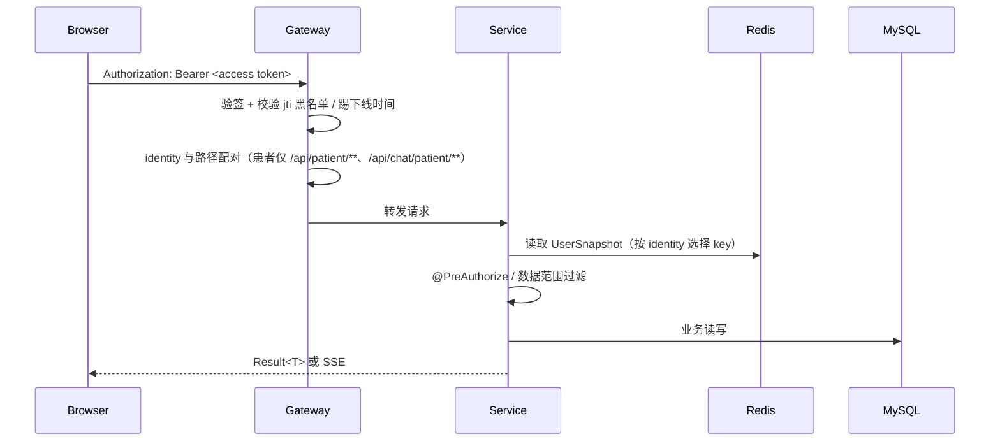
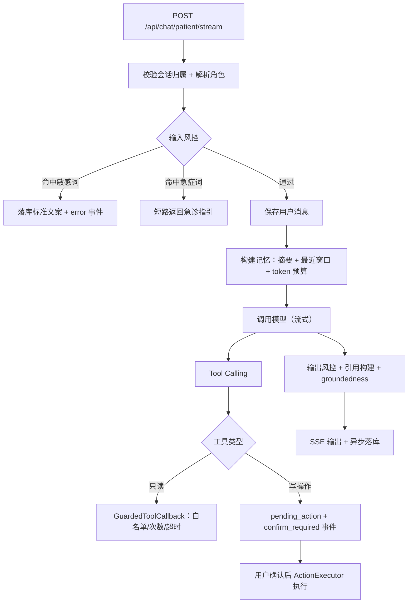
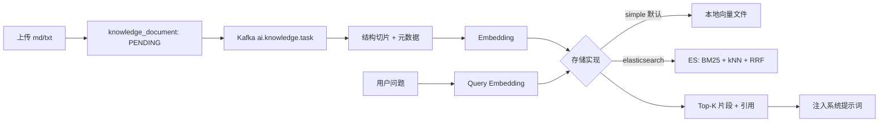
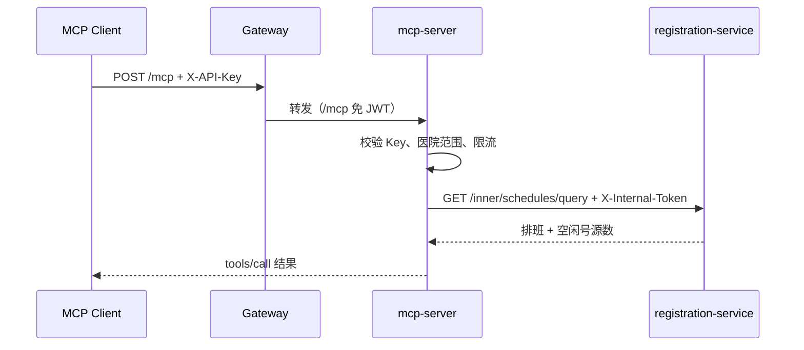

# 架构说明

本文说明系统的服务边界、身份链路、数据归属与 AI 编排方式。目标不是罗列技术栈，而是回答三个问题：**请求怎么走、数据归谁、AI 在哪里介入**。

## 1. 服务边界

| 服务 | 端口 | 职责 | 数据库 |
|------|------|------|--------|
| gateway | 8080 | 统一入口、JWT 验签、身份与路径配对、限流、`/inner/**` 外部阻断 | 无 |
| auth-service | 9200 | 员工/患者登录、JWT 签发与刷新、登出/踢下线、权限快照 | Redis |
| system-service | 9201 | 员工、角色、菜单、权限、患者账号、站内信、操作审计 | system_db |
| hospital-service | 9202 | 医院、科室、员工档案、出勤 | hospital_db |
| registration-service | 9203 | 排班、号源、预约、取号/退号/就诊、预约事件 | registration_db |
| ai-chat-service | 9204 | 会话、SSE 流式、导诊、写工具、RAG、知识库、评测支撑 | chat_db + 向量存储 |
| mcp-server | 9205 | 对外 MCP、API Key 认证、医院范围校验、限流与缓存 | 无（Redis 缓存/限流） |

公共模块：

- `common`：统一返回、异常、Kafka 主题与事件契约。
- `common-security`：JWT、权限快照、内部令牌、数据权限、审计注解、全局异常。
- `api`：Feign 客户端与服务间 DTO。

## 2. 身份与鉴权链路

系统有两条身份：`STAFF`（员工）与 `PATIENT`（患者）。两者使用同一套 JWT 签名机制，但快照、权限与可访问路径不同。

关键约束：

- 网关白名单只用于登录、注册、公开排班/医院、健康检查等匿名路径。
- `/inner/**` 只允许服务间携带内部令牌访问，外部请求在网关直接 403。
- 患者令牌不能访问员工接口，员工令牌也不能访问患者专属接口（`/api/qr/confirm` 为身份中立路径）。
- 服务侧仍会做二次校验：功能权限用 `@PreAuthorize`，数据权限用 `DataScopeResolver`，AI 写工具另有患者医院归属校验。

## 3. 数据归属

| 库 | 核心表 | 说明 |
|----|--------|------|
| system_db | `sys_user`、`sys_role`、`sys_menu`、`patient_user`、`sys_oper_log`、`notification` | 账号、RBAC、患者账号、审计与站内信 |
| hospital_db | `hospital`、`department`、`employee`、`attendance` | 医院组织与出勤 |
| registration_db | `doctor_schedule`、`number_source`、`registration` | 排班号源与预约状态机 |
| chat_db | `chat_session`、`chat_message`、`pending_action`、`knowledge_document`、`ai_role` | 会话、待确认操作、知识库元数据、AI 人设 |

跨库不建外键，服务间通过 Feign 内部接口获取权威数据；医院、患者、医生等展示字段在组装 VO 时批量回填。

## 4. AI 对话链路

患者端与员工端共用模型、记忆与工具底座，但入口、风控与工具集合不同。

设计要点：

- **会话归属**：所有会话按 `userId + identity` 过滤，患者只能访问自己的会话。
- **角色解析**：患者角色由 `scope + hospitalId + sessionType` 决定，库中不存在时惰性创建默认角色。
- **记忆预算**：`ConversationMemory` 将摘要与最近消息拼装到预算内；摘要只基于早期区重生成，避免被挤出消息丢失。
- **模型故障转移**：`ModelStreamExecutor` 在首 token 前失败时切换备用模型；写工具场景禁用转移，避免重复副作用。
- **工具护栏**：`GuardedToolCallback` 统一做参数复核、调用次数上限、超时与结构化错误。
- **二次确认**：写工具不直接执行，先生成 `pending_action`；确认接口用条件更新防重放，过期自动失效。
- **输出可信**：RAG 回答附带 `references` 事件并持久化；`GroundednessChecker` 对关键事实做覆盖校验。

## 5. RAG 知识库

- 默认 `AI_RAG_STORE=simple`，无需 ES 即可运行；设置 `elasticsearch` 后启用 BM25 + kNN 混合检索。
- 检索始终带 `hospitalId` 过滤，避免跨院知识泄露。
- 上传后状态由 `PENDING → PROCESSING → COMPLETED/FAILED` 流转；失败与重试由 Kafka 消费者承接。

## 6. 异步与可观测性

Kafka 主题：

| 主题 | 生产者 | 消费者用途 |
|------|--------|------------|
| `ai.registration.event` | registration-service | 站内信通知 |
| `ai.audit.log` | 各服务审计切面 | system-service 审计落库 |
| `ai.knowledge.task` | ai-chat-service | 知识库切片/向量化 |
| `*.DLT` | Kafka 消费者 | 重试耗尽后的死信 |

通用约定：生产者 `acks=all`，消费者手动 ack、按事件 ID 幂等，失败进入死信主题。

可观测性：

- 网关与服务统一透传 `traceId`，接入 Zipkin。
- Prometheus 暴露 JVM、HTTP、AI 调用、工具调用、落库失败等指标。
- 审计日志异步化，避免阻塞主业务。

## 7. 已知边界

这些是当前版本的明确边界，不是隐藏缺陷：

- 支付是状态位模拟，未接真实支付/退款渠道。
- 匿名预约与登录预约并存，患者账号尚未做实名与家庭成员。
- 向量存储默认单机文件，多实例部署需要切换到 ES 或外部向量库。
- 事件链路未引入 outbox，生产失败只记录告警。
- 演示数据播种未按环境隔离，部署到公网前必须改用 `prod`/`demo` 配置。

后续演进方向见 [README](../../README.md)、[阅读路线](reading-guide.md) 与仓库 Issue。

## 8. 对外 MCP 链路

第三方 AI 客户端通过 Streamable HTTP 访问网关 `/mcp`，网关免 JWT 放行；mcp-server 校验 `X-API-Key` 并按 Key 绑定医院范围，再通过内部令牌调用 registration-service 与 hospital-service。现有 `/inner/**` 与 `/api/**` 的保护不变。

余量口径为 `number_source.status=1` 的数量；日期窗口最多 14 天，扫描上限 500 条、返回上限 100 条。
