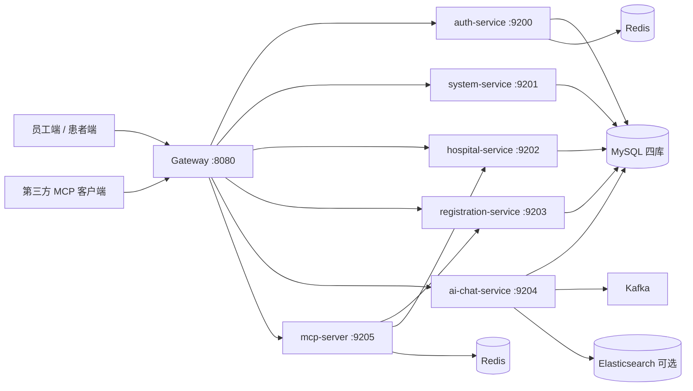
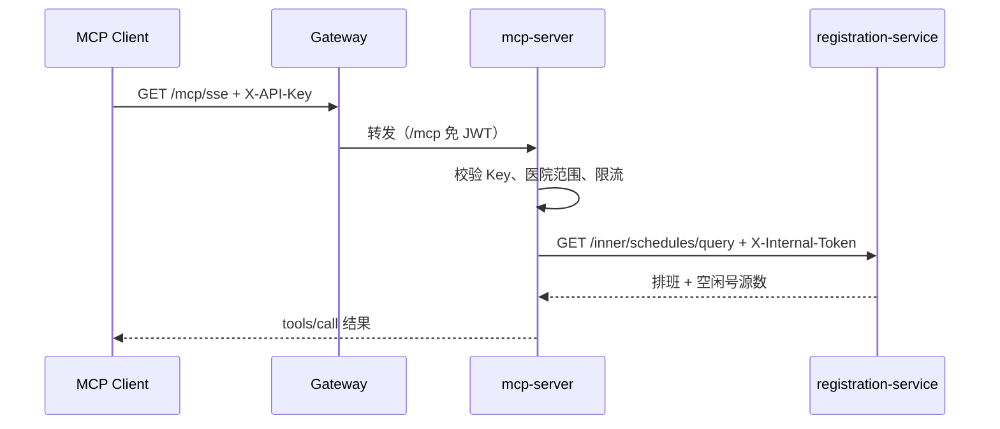

# 医院排班查询 MCP Server Implementation Plan

> **For agentic workers:** REQUIRED SUB-SKILL: Use superpowers:subagent-driven-development (recommended) or superpowers:executing-plans to implement this plan task-by-task. Steps use checkbox (`- [ ]`) syntax for tracking.

**Goal:** 新增对外只读 MCP Server，第三方凭 API Key 查询 Key 绑定医院的未来 14 天医生排班与真实号源余量。

**Architecture:** registration-service 新增内部查询接口，余量按 `number_source.status=1` 统计；新增独立 `services/mcp-server` 模块承载 SSE MCP（`/mcp/sse` + `/mcp/message`）、API Key 认证、医院范围校验、Redis 缓存与限流；网关只放行 `/mcp`，内部接口继续受 `X-Internal-Token` 保护。

**Tech Stack:** Java 17 · Spring Boot 3.5.16 · Spring AI 1.0.9（`spring-ai-starter-mcp-server-webmvc`）· Spring Cloud 2025.0.3 / Nacos · OpenFeign · Redisson · Redis · JUnit 5 + Mockito。

**Spec:** [docs/design/mcp-schedule-design.md](mcp-schedule-design.md)

> **修订说明（2026-10-21 终审）**：本计划早期任务中的 Streamable HTTP 代码片段已被最终实现取代。当前实现使用 SSE（`/mcp/sse` + `/mcp/message`），调用方通过 `McpTransportContext` / `ToolContext` 传递而非 ThreadLocal；以下早期片段仅作历史记录，以设计文档与最终代码为准。

## Global Constraints

- 分支固定为 `refactor/spring-cloud`，只做本地提交，不 push、不合并、不建 PR。
- **执行代理不得运行 `mvn compile/test`，不得启动任何服务**（用户规则）。计划中的 Maven 命令由用户或 CI 执行；代理只做代码阅读、`grep` 与静态自检，不得声称测试已通过。
- 不改前端，不改现有 `/api/registration/schedule/public/**` 行为，不新增数据库表。
- 仓库内不得出现真实 API Key；Nacos 示例文件只放占位符。
- 日期一律使用 `Asia/Shanghai`，不得依赖 JVM 默认时区。
- 新增 Java 类必须有类 Javadoc（`@author yh`、`@date 2026-10-21`）；公共方法使用多行 Javadoc 并标注 `@param`/`@return`，摘要行不加句号。
- 对外错误文案使用中文；不得返回患者信息、`registration_id`、Key 明文。
- 仅使用现有依赖版本，不升级 Spring Boot / Spring AI / Spring Cloud。
- 所有 Feign 调用继续由 `api` 模块的 `InternalTokenInterceptor` 注入 `X-Internal-Token`，不得手写令牌。

## Dependency Graph

```text
Task 1 (api 契约) ──► Task 2 (registration 查询) ──┐
                                                    ├──► Task 6 (MCP 工具) ──► Task 8 (文档与验收)
Task 3 (模块骨架/限流/指标) ──► Task 4 (API Key 认证) ┤
                            └─► Task 5 (缓存/限流测试) ┘
Task 7 (网关/脚本/Nacos 示例) ──────────────────────┘
```

可并行：Task 1、Task 3、Task 7 互不依赖；Task 2 等 Task 1；Task 4、Task 5 等 Task 3；Task 6 等 Task 2/4/5；Task 8 等全部。

---

### Task 1: api 模块查询契约

**Files:**
- Create: `ai-assistant-backend/api/src/main/java/com/api/dto/DoctorScheduleInfoDTO.java`
- Create: `ai-assistant-backend/api/src/main/java/com/api/dto/ScheduleQueryResultDTO.java`
- Modify: `ai-assistant-backend/api/src/main/java/com/api/client/RegistrationClient.java`

**Interfaces:**
- Consumes: 无。
- Produces:
  - `DoctorScheduleInfoDTO`
  - `ScheduleQueryResultDTO`（`getItems()`、`isTruncated()`、静态 `empty()`）
  - `RegistrationClient.querySchedules(Long hospitalId, String dateFrom, String dateTo, Long departmentId, Integer period, String doctorName)` 返回 `Result<ScheduleQueryResultDTO>`

- [ ] **Step 1: 新建 `DoctorScheduleInfoDTO`**

```java
package com.api.dto;

import lombok.Data;

/**
 * 对外排班查询的单条结果
 *
 * @author yh
 * @date 2026-10-21
 */
@Data
public class DoctorScheduleInfoDTO {

    /** 医院 ID */
    private Long hospitalId;

    /** 医院名称 */
    private String hospitalName;

    /** 科室 ID */
    private Long departmentId;

    /** 科室名称 */
    private String departmentName;

    /** 医生用户 ID */
    private Long doctorUserId;

    /** 医生姓名 */
    private String doctorName;

    /** 出诊日期（yyyy-MM-dd） */
    private String scheduleDate;

    /** 时段：1-上午，2-下午 */
    private Integer period;

    /** 时段名称 */
    private String periodText;

    /** 号源总数 */
    private Integer totalLimit;

    /** 余量（空闲号源数） */
    private Integer remainingCount;
}
```

- [ ] **Step 2: 新建 `ScheduleQueryResultDTO`**

```java
package com.api.dto;

import lombok.Data;

import java.util.ArrayList;
import java.util.List;

/**
 * 对外排班查询结果
 *
 * @author yh
 * @date 2026-10-21
 */
@Data
public class ScheduleQueryResultDTO {

    /** 排班列表 */
    private List<DoctorScheduleInfoDTO> items = new ArrayList<>();

    /** 是否因扫描或返回上限被截断 */
    private boolean truncated;

    /**
     * 构造空结果
     *
     * @return 空结果
     */
    public static ScheduleQueryResultDTO empty() {
        return new ScheduleQueryResultDTO();
    }
}
```

- [ ] **Step 3: 在 `RegistrationClient` 增加查询方法**

在接口末尾追加：

```java
    /** 按医院+日期窗口查询排班与余量（对外 MCP 只读查询） */
    @GetMapping("/schedules/query")
    Result<ScheduleQueryResultDTO> querySchedules(@RequestParam("hospitalId") Long hospitalId,
                                                  @RequestParam("dateFrom") String dateFrom,
                                                  @RequestParam("dateTo") String dateTo,
                                                  @RequestParam(value = "departmentId", required = false) Long departmentId,
                                                  @RequestParam(value = "period", required = false) Integer period,
                                                  @RequestParam(value = "doctorName", required = false) String doctorName);
```

补充 import：

```java
import com.api.dto.ScheduleQueryResultDTO;
```

- [ ] **Step 4: 静态自检**

```bash
grep -n "querySchedules" ai-assistant-backend/api/src/main/java/com/api/client/RegistrationClient.java
grep -n "class ScheduleQueryResultDTO\|class DoctorScheduleInfoDTO" ai-assistant-backend/api/src/main/java/com/api/dto/*.java
```

Expected: 两处类定义存在，方法签名包含 6 个参数且返回 `Result<ScheduleQueryResultDTO>`。

- [ ] **Step 5: 本地提交**

```bash
git add ai-assistant-backend/api/src/main/java/com/api/dto/DoctorScheduleInfoDTO.java \
        ai-assistant-backend/api/src/main/java/com/api/dto/ScheduleQueryResultDTO.java \
        ai-assistant-backend/api/src/main/java/com/api/client/RegistrationClient.java
git commit -m "feat(api): 增加对外排班查询契约"
```

---

### Task 2: registration-service 内部查询

**Files:**
- Modify: `ai-assistant-backend/services/registration-service/src/main/java/com/registration/service/DoctorScheduleService.java`
- Modify: `ai-assistant-backend/services/registration-service/src/main/java/com/registration/service/impl/DoctorScheduleServiceImpl.java`
- Modify: `ai-assistant-backend/services/registration-service/src/main/java/com/registration/controller/inner/InnerRegistrationController.java`
- Test: `ai-assistant-backend/services/registration-service/src/test/java/com/registration/service/impl/DoctorScheduleExternalQueryTest.java`

**Interfaces:**
- Consumes: Task 1 的 `DoctorScheduleInfoDTO`、`ScheduleQueryResultDTO`。
- Produces:
  - `DoctorScheduleService.queryForExternal(Long hospitalId, String dateFrom, String dateTo, Long departmentId, Integer period, String doctorName)` 返回 `ScheduleQueryResultDTO`
  - `GET /inner/schedules/query` 内部端点

- [ ] **Step 1: 先写测试 `DoctorScheduleExternalQueryTest`**

```java
package com.registration.service.impl;

import com.api.client.OrgClient;
import com.api.client.UserClient;
import com.api.dto.OrgBriefDTO;
import com.api.dto.ScheduleQueryResultDTO;
import com.api.dto.UserBriefDTO;
import com.common.exception.BusinessException;
import com.common.result.Result;
import com.common.security.DataScopeResolver;
import com.registration.entity.DoctorSchedule;
import com.registration.entity.NumberSource;
import com.registration.mapper.DoctorScheduleMapper;
import com.registration.mapper.NumberSourceMapper;
import com.registration.mapper.RegistrationMapper;
import com.registration.mq.RegistrationEventPublisher;
import com.registration.service.NumberSourceService;
import com.registration.support.ScheduleLock;
import org.junit.jupiter.api.BeforeEach;
import org.junit.jupiter.api.Test;
import org.junit.jupiter.api.extension.ExtendWith;
import org.mockito.InjectMocks;
import org.mockito.Mock;
import org.mockito.junit.jupiter.MockitoExtension;
import org.springframework.transaction.support.TransactionTemplate;

import java.time.LocalDate;
import java.util.List;
import java.util.stream.IntStream;

import static org.junit.jupiter.api.Assertions.assertEquals;
import static org.junit.jupiter.api.Assertions.assertThrows;
import static org.junit.jupiter.api.Assertions.assertTrue;
import static org.mockito.ArgumentMatchers.any;
import static org.mockito.ArgumentMatchers.anyList;
import static org.mockito.Mockito.lenient;
import static org.mockito.Mockito.when;

/**
 * 对外排班查询单测
 *
 * @author yh
 * @date 2026-10-21
 */
@ExtendWith(MockitoExtension.class)
class DoctorScheduleExternalQueryTest {

    @Mock
    private DoctorScheduleMapper scheduleMapper;
    @Mock
    private NumberSourceMapper numberSourceMapper;
    @Mock
    private NumberSourceService numberSourceService;
    @Mock
    private UserClient userClient;
    @Mock
    private OrgClient orgClient;
    @Mock
    private DataScopeResolver dataScopeResolver;
    @Mock
    private RegistrationMapper registrationMapper;
    @Mock
    private RegistrationEventPublisher eventPublisher;
    @Mock
    private ScheduleLock scheduleLock;
    @Mock
    private TransactionTemplate txTemplate;

    @InjectMocks
    private DoctorScheduleServiceImpl service;

    @BeforeEach
    void setUp() {
        lenient().when(orgClient.hospitals(anyList()))
                .thenReturn(Result.success(List.of(org(1L, "示例医院"))));
        lenient().when(orgClient.departments(anyList()))
                .thenReturn(Result.success(List.of(org(10L, "内科"))));
        lenient().when(userClient.batch(anyList()))
                .thenReturn(Result.success(List.of(user(100L, "张三"), user(101L, "李四"))));
    }

    @Test
    void countsOnlyFreeSourcesForRemaining() {
        when(scheduleMapper.selectList(any()))
                .thenReturn(List.of(schedule(1L, 100L), schedule(2L, 101L)));
        when(numberSourceMapper.selectList(any()))
                .thenReturn(List.of(freeSource(1L), freeSource(1L), freeSource(2L)));

        ScheduleQueryResultDTO result = service.queryForExternal(
                1L, "2099-01-01", "2099-01-01", null, null, null);

        assertEquals(2, result.getItems().size());
        assertEquals(2, result.getItems().get(0).getRemainingCount());
        assertEquals(1, result.getItems().get(1).getRemainingCount());
    }

    @Test
    void filtersByDoctorNameIgnoringCaseAndSpaces() {
        when(scheduleMapper.selectList(any()))
                .thenReturn(List.of(schedule(1L, 100L), schedule(2L, 101L)));
        when(numberSourceMapper.selectList(any())).thenReturn(List.of());

        ScheduleQueryResultDTO result = service.queryForExternal(
                1L, "2099-01-01", "2099-01-01", null, null, " 张 ");

        assertEquals(1, result.getItems().size());
        assertEquals("张三", result.getItems().get(0).getDoctorName());
    }

    @Test
    void rejectsWindowLongerThanFourteenDays() {
        BusinessException ex = assertThrows(BusinessException.class,
                () -> service.queryForExternal(1L, "2099-01-01", "2099-01-20", null, null, null));

        assertTrue(ex.getMessage().contains("14"));
    }

    @Test
    void rejectsStartDateAfterEndDate() {
        BusinessException ex = assertThrows(BusinessException.class,
                () -> service.queryForExternal(1L, "2099-01-10", "2099-01-01", null, null, null));

        assertTrue(ex.getMessage().contains("开始日期不能晚于结束日期"));
    }

    @Test
    void rejectsInvalidPeriod() {
        BusinessException ex = assertThrows(BusinessException.class,
                () -> service.queryForExternal(1L, "2099-01-01", "2099-01-01", null, 3, null));

        assertTrue(ex.getMessage().contains("时段"));
    }

    @Test
    void rejectsMissingHospitalId() {
        BusinessException ex = assertThrows(BusinessException.class,
                () -> service.queryForExternal(null, "2099-01-01", "2099-01-01", null, null, null));

        assertTrue(ex.getMessage().contains("医院"));
    }

    @Test
    void truncatesToHundredRows() {
        List<DoctorSchedule> schedules = IntStream.rangeClosed(1, 101)
                .mapToObj(i -> schedule((long) i, 100L))
                .toList();
        when(scheduleMapper.selectList(any())).thenReturn(schedules);
        when(numberSourceMapper.selectList(any())).thenReturn(List.of());

        ScheduleQueryResultDTO result = service.queryForExternal(
                1L, "2099-01-01", "2099-01-01", null, null, null);

        assertEquals(100, result.getItems().size());
        assertTrue(result.isTruncated());
    }

    private static DoctorSchedule schedule(Long id, Long doctorUserId) {
        DoctorSchedule schedule = new DoctorSchedule();
        schedule.setId(id);
        schedule.setHospitalId(1L);
        schedule.setDepartmentId(10L);
        schedule.setDoctorUserId(doctorUserId);
        schedule.setScheduleDate(LocalDate.of(2099, 1, 1));
        schedule.setPeriod(1);
        schedule.setTotalLimit(20);
        schedule.setStatus(1);
        return schedule;
    }

    private static NumberSource freeSource(Long scheduleId) {
        NumberSource source = new NumberSource();
        source.setScheduleId(scheduleId);
        source.setStatus(1);
        return source;
    }

    private static OrgBriefDTO org(Long id, String name) {
        OrgBriefDTO dto = new OrgBriefDTO();
        dto.setId(id);
        dto.setName(name);
        return dto;
    }

    private static UserBriefDTO user(Long id, String name) {
        UserBriefDTO dto = new UserBriefDTO();
        dto.setId(id);
        dto.setName(name);
        return dto;
    }
}
```

- [ ] **Step 2: 在 `DoctorScheduleService` 增加接口方法**

```java
    /**
     * 对外只读查询：按医院与日期窗口返回排班及空闲号源数
     *
     * @param hospitalId 医院 ID
     * @param dateFrom 开始日期（yyyy-MM-dd）
     * @param dateTo 结束日期（yyyy-MM-dd）
     * @param departmentId 科室 ID（可空）
     * @param period 时段（可空）
     * @param doctorName 医生姓名关键字（可空）
     * @return 排班查询结果
     */
    com.api.dto.ScheduleQueryResultDTO queryForExternal(Long hospitalId, String dateFrom, String dateTo,
                                                        Long departmentId, Integer period, String doctorName);
```

- [ ] **Step 3: 在 `DoctorScheduleServiceImpl` 实现查询**

在类中补充 import：

```java
import com.api.dto.DoctorScheduleInfoDTO;
import com.api.dto.ScheduleQueryResultDTO;
import com.registration.entity.NumberSource;
import java.time.ZoneId;
import java.time.format.DateTimeParseException;
import java.util.Locale;
```

在类字段区补充常量：

```java
    /** 对外查询最大日期窗口（含首尾） */
    private static final int MAX_WINDOW_DAYS = 14;
    /** 数据库扫描上限 */
    private static final int MAX_SCAN_ROWS = 500;
    /** 单次返回上限 */
    private static final int MAX_RETURN_ROWS = 100;
```

在 `listPublic` 方法之后插入：

```java
    @Override
    public ScheduleQueryResultDTO queryForExternal(Long hospitalId, String dateFrom, String dateTo,
                                                   Long departmentId, Integer period, String doctorName) {
        if (hospitalId == null) {
            throw new BusinessException("医院ID不能为空");
        }
        LocalDate from = parseDate(dateFrom, "开始日期");
        LocalDate to = parseDate(dateTo, "结束日期");
        LocalDate today = LocalDate.now(ZoneId.of("Asia/Shanghai"));
        if (from.isBefore(today)) {
            from = today;
        }
        if (from.isAfter(to)) {
            throw new BusinessException("开始日期不能晚于结束日期");
        }
        if (to.isAfter(from.plusDays(MAX_WINDOW_DAYS - 1))) {
            throw new BusinessException("查询窗口最多 " + MAX_WINDOW_DAYS + " 天");
        }
        if (period != null && period != 1 && period != 2) {
            throw new BusinessException("时段仅支持 1=上午、2=下午");
        }

        LambdaQueryWrapper<DoctorSchedule> qw = new LambdaQueryWrapper<>();
        qw.eq(DoctorSchedule::getHospitalId, hospitalId)
                .eq(DoctorSchedule::getStatus, 1)
                .ge(DoctorSchedule::getScheduleDate, from)
                .le(DoctorSchedule::getScheduleDate, to);
        if (departmentId != null) {
            qw.eq(DoctorSchedule::getDepartmentId, departmentId);
        }
        if (period != null) {
            qw.eq(DoctorSchedule::getPeriod, period);
        }
        qw.orderByAsc(DoctorSchedule::getScheduleDate)
                .orderByAsc(DoctorSchedule::getPeriod)
                .orderByAsc(DoctorSchedule::getId)
                .last("LIMIT " + (MAX_SCAN_ROWS + 1));

        List<DoctorSchedule> schedules = scheduleMapper.selectList(qw);
        boolean truncated = schedules.size() > MAX_SCAN_ROWS;
        if (truncated) {
            schedules = schedules.subList(0, MAX_SCAN_ROWS);
        }
        if (schedules.isEmpty()) {
            return ScheduleQueryResultDTO.empty();
        }

        Map<Long, Long> freeCounts = loadFreeCounts(
                schedules.stream().map(DoctorSchedule::getId).toList());
        List<ScheduleVO> views = enrich(schedules);
        for (ScheduleVO view : views) {
            view.setRemaining(freeCounts.getOrDefault(view.getId(), 0L).intValue());
        }

        String keyword = doctorName == null ? null : doctorName.trim().toLowerCase(Locale.ROOT);
        if (keyword != null && !keyword.isEmpty()) {
            views = views.stream()
                    .filter(v -> v.getDoctorName() != null
                            && v.getDoctorName().toLowerCase(Locale.ROOT).contains(keyword))
                    .toList();
        }
        if (views.size() > MAX_RETURN_ROWS) {
            views = views.subList(0, MAX_RETURN_ROWS);
            truncated = true;
        }

        ScheduleQueryResultDTO result = new ScheduleQueryResultDTO();
        result.setItems(views.stream().map(DoctorScheduleServiceImpl::toExternalItem).toList());
        result.setTruncated(truncated);
        return result;
    }

    /**
     * 解析日期并转换为业务异常
     *
     * @param value 日期文本
     * @param field 字段名称
     * @return 日期
     */
    private static LocalDate parseDate(String value, String field) {
        if (value == null || value.isBlank()) {
            throw new BusinessException(field + "不能为空");
        }
        try {
            return LocalDate.parse(value.trim());
        } catch (DateTimeParseException e) {
            throw new BusinessException(field + "格式应为 yyyy-MM-dd");
        }
    }

    /**
     * 批量统计各排班的空闲号源数
     *
     * @param scheduleIds 排班 ID 列表
     * @return 排班 ID 到空闲号源数的映射
     */
    private Map<Long, Long> loadFreeCounts(List<Long> scheduleIds) {
        List<NumberSource> sources = numberSourceMapper.selectList(
                new LambdaQueryWrapper<NumberSource>()
                        .in(NumberSource::getScheduleId, scheduleIds)
                        .eq(NumberSource::getStatus, 1));
        return sources.stream()
                .collect(Collectors.groupingBy(NumberSource::getScheduleId, Collectors.counting()));
    }

    /**
     * 排班视图转对外 DTO
     *
     * @param vo 排班视图
     * @return 对外排班信息
     */
    private static DoctorScheduleInfoDTO toExternalItem(ScheduleVO vo) {
        DoctorScheduleInfoDTO dto = new DoctorScheduleInfoDTO();
        dto.setHospitalId(vo.getHospitalId());
        dto.setHospitalName(vo.getHospitalName());
        dto.setDepartmentId(vo.getDepartmentId());
        dto.setDepartmentName(vo.getDepartmentName());
        dto.setDoctorUserId(vo.getDoctorUserId());
        dto.setDoctorName(vo.getDoctorName());
        dto.setScheduleDate(vo.getScheduleDate() == null ? null : vo.getScheduleDate().toString());
        dto.setPeriod(vo.getPeriod());
        dto.setPeriodText(vo.getPeriodText());
        dto.setTotalLimit(vo.getTotalLimit());
        dto.setRemainingCount(vo.getRemaining());
        return dto;
    }
```

- [ ] **Step 4: 在 `InnerRegistrationController` 增加端点**

在字段区补充：

```java
    private final DoctorScheduleService scheduleService;
```

在类末尾追加：

```java
    /**
     * 对外 MCP 排班查询（按医院与日期窗口，只读）
     *
     * @param hospitalId 医院 ID
     * @param dateFrom 开始日期（yyyy-MM-dd）
     * @param dateTo 结束日期（yyyy-MM-dd）
     * @param departmentId 科室 ID（可空）
     * @param period 时段（可空）
     * @param doctorName 医生姓名关键字（可空）
     * @return 排班与余量查询结果
     */
    @GetMapping("/schedules/query")
    public Result<ScheduleQueryResultDTO> querySchedules(
            @RequestParam("hospitalId") Long hospitalId,
            @RequestParam("dateFrom") String dateFrom,
            @RequestParam("dateTo") String dateTo,
            @RequestParam(value = "departmentId", required = false) Long departmentId,
            @RequestParam(value = "period", required = false) Integer period,
            @RequestParam(value = "doctorName", required = false) String doctorName) {
        return Result.success(scheduleService.queryForExternal(
                hospitalId, dateFrom, dateTo, departmentId, period, doctorName));
    }
```

补充 import：

```java
import com.api.dto.ScheduleQueryResultDTO;
import com.registration.service.DoctorScheduleService;
```

- [ ] **Step 5: 静态自检**

```bash
grep -n "queryForExternal" ai-assistant-backend/services/registration-service/src/main/java/com/registration/service/DoctorScheduleService.java \
  ai-assistant-backend/services/registration-service/src/main/java/com/registration/service/impl/DoctorScheduleServiceImpl.java
grep -n "schedules/query" ai-assistant-backend/services/registration-service/src/main/java/com/registration/controller/inner/InnerRegistrationController.java
grep -n "status, 1" ai-assistant-backend/services/registration-service/src/main/java/com/registration/service/impl/DoctorScheduleServiceImpl.java
```

Expected: 接口与实现签名一致；端点存在；空闲号源查询带 `status=1`。

- [ ] **Step 6: 本地提交**

```bash
git add ai-assistant-backend/services/registration-service/src/main/java/com/registration/service/DoctorScheduleService.java \
        ai-assistant-backend/services/registration-service/src/main/java/com/registration/service/impl/DoctorScheduleServiceImpl.java \
        ai-assistant-backend/services/registration-service/src/main/java/com/registration/controller/inner/InnerRegistrationController.java \
        ai-assistant-backend/services/registration-service/src/test/java/com/registration/service/impl/DoctorScheduleExternalQueryTest.java
git commit -m "feat(registration): 新增对外排班查询内部接口"
```

**用户验证命令（不由代理执行）：**

```bash
cd ai-assistant-backend
./mvnw -pl services/registration-service -am test -Dtest=DoctorScheduleExternalQueryTest
```

---

### Task 3: mcp-server 模块骨架与基础组件

**Files:**
- Modify: `ai-assistant-backend/pom.xml`
- Create: `ai-assistant-backend/services/mcp-server/pom.xml`
- Create: `ai-assistant-backend/services/mcp-server/src/main/java/com/mcp/McpServerApplication.java`
- Create: `ai-assistant-backend/services/mcp-server/src/main/java/com/mcp/config/McpProperties.java`
- Create: `ai-assistant-backend/services/mcp-server/src/main/java/com/mcp/ratelimit/McpRateLimiter.java`
- Create: `ai-assistant-backend/services/mcp-server/src/main/java/com/mcp/support/McpMetrics.java`
- Create: `ai-assistant-backend/services/mcp-server/src/main/resources/application.yml`
- Test: `ai-assistant-backend/services/mcp-server/src/test/java/com/mcp/config/McpPropertiesTest.java`

**Interfaces:**
- Consumes: 无。
- Produces:
  - `McpProperties`（`getAuth().getKeys()`、`getCache().getTtlSeconds()`）
  - `McpRateLimiter.tryAcquire(String consumer, Integer limitPerMinute)` 返回 `boolean`
  - `McpMetrics.toolCall/authFailure/rateLimited`
  - `McpServerApplication`、端口 9205。

- [ ] **Step 1: 父 POM 注册模块**

在 `<modules>` 中 `services/registration-service` 之后追加：

```xml
        <module>services/mcp-server</module>
```

- [ ] **Step 2: 新建模块 POM**

```xml
<?xml version="1.0" encoding="UTF-8"?>
<project xmlns="http://maven.apache.org/POM/4.0.0"
         xmlns:xsi="http://www.w3.org/2001/XMLSchema-instance"
         xsi:schemaLocation="http://maven.apache.org/POM/4.0.0 https://maven.apache.org/xsd/maven-4.0.0.xsd">
    <modelVersion>4.0.0</modelVersion>

    <parent>
        <groupId>com.aiassistant</groupId>
        <artifactId>ai-assistant-backend</artifactId>
        <version>1.0.0</version>
        <relativePath>../..</relativePath>
    </parent>

    <artifactId>mcp-server</artifactId>

    <dependencies>
        <dependency>
            <groupId>com.aiassistant</groupId>
            <artifactId>common</artifactId>
        </dependency>
        <dependency>
            <groupId>com.aiassistant</groupId>
            <artifactId>api</artifactId>
        </dependency>
        <dependency>
            <groupId>org.springframework.boot</groupId>
            <artifactId>spring-boot-starter-web</artifactId>
        </dependency>
        <dependency>
            <groupId>org.springframework.ai</groupId>
            <artifactId>spring-ai-starter-mcp-server-webmvc</artifactId>
        </dependency>
        <dependency>
            <groupId>com.alibaba.cloud</groupId>
            <artifactId>spring-cloud-starter-alibaba-nacos-discovery</artifactId>
        </dependency>
        <dependency>
            <groupId>com.alibaba.cloud</groupId>
            <artifactId>spring-cloud-starter-alibaba-nacos-config</artifactId>
        </dependency>
        <dependency>
            <groupId>org.redisson</groupId>
            <artifactId>redisson-spring-boot-starter</artifactId>
        </dependency>
        <dependency>
            <groupId>org.projectlombok</groupId>
            <artifactId>lombok</artifactId>
        </dependency>
        <dependency>
            <groupId>org.springframework.boot</groupId>
            <artifactId>spring-boot-starter-test</artifactId>
            <scope>test</scope>
        </dependency>
    </dependencies>

    <build>
        <plugins>
            <plugin>
                <groupId>org.springframework.boot</groupId>
                <artifactId>spring-boot-maven-plugin</artifactId>
            </plugin>
        </plugins>
    </build>
</project>
```

> 若 `spring-ai-starter-mcp-server-webmvc` 无法按 1.0.9 解析，**停止并报告**，不要自行换版本或替换为其他 MCP 实现。

- [ ] **Step 3: 新建启动类**

```java
package com.mcp;

import com.mcp.config.McpProperties;
import org.springframework.boot.SpringApplication;
import org.springframework.boot.autoconfigure.SpringBootApplication;
import org.springframework.boot.context.properties.EnableConfigurationProperties;
import org.springframework.cloud.openfeign.EnableFeignClients;

/**
 * 对外排班查询 MCP Server 启动类
 *
 * @author yh
 * @date 2026-10-21
 */
@EnableConfigurationProperties(McpProperties.class)
@EnableFeignClients("com.api.client")
@SpringBootApplication(scanBasePackages = {"com.mcp", "com.api"})
public class McpServerApplication {

    public static void main(String[] args) {
        SpringApplication.run(McpServerApplication.class, args);
    }
}
```

- [ ] **Step 4: 新建 `McpProperties`**

```java
package com.mcp.config;

import lombok.Data;
import org.springframework.boot.context.properties.ConfigurationProperties;

import java.util.ArrayList;
import java.util.List;

/**
 * MCP 对外服务配置
 *
 * @author yh
 * @date 2026-10-21
 */
@Data
@ConfigurationProperties(prefix = "mcp")
public class McpProperties {

    /** 认证配置 */
    private Auth auth = new Auth();

    /** 缓存配置 */
    private Cache cache = new Cache();

    /**
     * API Key 认证配置
     */
    @Data
    public static class Auth {

        /** Key 列表 */
        private List<Key> keys = new ArrayList<>();
    }

    /**
     * 单个调用方 Key
     */
    @Data
    public static class Key {

        /** 调用方标识 */
        private String consumer;

        /** Key 的 SHA-256 十六进制值 */
        private String keySha256;

        /** 允许访问的医院 ID */
        private List<Long> hospitalIds = new ArrayList<>();

        /** 每分钟请求上限 */
        private Integer rateLimitPerMinute = 60;

        /** 是否启用 */
        private boolean enabled = true;
    }

    /**
     * 查询缓存配置
     */
    @Data
    public static class Cache {

        /** 缓存秒数，0 表示关闭 */
        private long ttlSeconds = 45;
    }
}
```

- [ ] **Step 5: 新建 `McpRateLimiter`**

```java
package com.mcp.ratelimit;

import lombok.RequiredArgsConstructor;
import lombok.extern.slf4j.Slf4j;
import org.redisson.api.RAtomicLong;
import org.redisson.api.RedissonClient;
import org.springframework.stereotype.Component;

import java.time.Duration;

/**
 * MCP 调用方分钟级限流
 *
 * @author yh
 * @date 2026-10-21
 */
@Slf4j
@Component
@RequiredArgsConstructor
public class McpRateLimiter {

    private final RedissonClient redissonClient;

    /**
     * 尝试获取一次调用配额
     *
     * @param consumer 调用方标识
     * @param limitPerMinute 每分钟上限
     * @return 是否允许本次调用
     */
    public boolean tryAcquire(String consumer, Integer limitPerMinute) {
        if (limitPerMinute == null || limitPerMinute <= 0) {
            return true;
        }
        long minute = System.currentTimeMillis() / 60_000L;
        String key = "mcp:rate:" + consumer + ":" + minute;
        try {
            RAtomicLong counter = redissonClient.getAtomicLong(key);
            long current = counter.incrementAndGet();
            if (current == 1) {
                counter.expire(Duration.ofSeconds(70));
            }
            return current <= limitPerMinute;
        } catch (Exception e) {
            log.warn("MCP 限流不可用，放行本次调用: consumer={}, {}", consumer, e.getMessage());
            return true;
        }
    }
}
```

- [ ] **Step 6: 新建 `McpMetrics`**

```java
package com.mcp.support;

import io.micrometer.core.instrument.MeterRegistry;
import lombok.RequiredArgsConstructor;
import org.springframework.stereotype.Component;

import java.util.concurrent.TimeUnit;

/**
 * MCP 访问指标
 *
 * @author yh
 * @date 2026-10-21
 */
@Component
@RequiredArgsConstructor
public class McpMetrics {

    private final MeterRegistry meterRegistry;

    /**
     * 记录工具调用
     *
     * @param tool 工具名
     * @param outcome 结果
     * @param nanos 耗时（纳秒）
     */
    public void toolCall(String tool, String outcome, long nanos) {
        meterRegistry.counter("mcp.tool.calls", "tool", tool, "outcome", outcome).increment();
        meterRegistry.timer("mcp.tool.duration", "tool", tool).record(nanos, TimeUnit.NANOSECONDS);
    }

    /**
     * 记录认证失败
     *
     * @param reason 原因
     */
    public void authFailure(String reason) {
        meterRegistry.counter("mcp.auth.failures", "reason", reason).increment();
    }

    /**
     * 记录限流
     *
     * @param consumer 调用方
     */
    public void rateLimited(String consumer) {
        meterRegistry.counter("mcp.rate.limited", "consumer", consumer).increment();
    }
}
```

- [ ] **Step 7: 新建 `application.yml`**

```yaml
server:
  port: 9205

spring:
  application:
    name: mcp-server
  cloud:
    nacos:
      discovery:
        server-addr: 127.0.0.1:8848
    openfeign:
      client:
        config:
          default:
            connect-timeout: 2000
            read-timeout: 5000
  config:
    import:
      - optional:nacos:common-shared.yaml?group=DEFAULT_GROUP
      - optional:nacos:mcp-shared.yaml?group=DEFAULT_GROUP
  data:
    redis:
      host: localhost
      port: 6379
      database: 0
      timeout: 5000ms
  ai:
    mcp:
      server:
        name: ai-hospital-schedule
        version: 1.0.0
        type: SYNC
        capabilities:
          resource: false
          prompt: false
          completion: false
        sse-endpoint: /mcp/sse
        sse-message-endpoint: /mcp/message

security:
  internal:
    token: ${INTERNAL_TOKEN:aidaima-internal-token-please-override}

management:
  endpoints:
    web:
      exposure:
        include: health,info,prometheus
  tracing:
    sampling:
      probability: ${TRACING_SAMPLING:1.0}
  zipkin:
    tracing:
      endpoint: ${ZIPKIN_ENDPOINT:http://localhost:9411/api/v2/spans}

logging:
  level:
    com.mcp: info
    com.common: info
  pattern:
    level: "%5p [${spring.application.name:},%X{traceId:-},%X{spanId:-}]"
```

- [ ] **Step 8: 写配置绑定测试**

```java
package com.mcp.config;

import org.junit.jupiter.api.Test;
import org.springframework.boot.context.properties.EnableConfigurationProperties;
import org.springframework.boot.test.context.runner.ApplicationContextRunner;
import org.springframework.context.annotation.Configuration;

import static org.junit.jupiter.api.Assertions.assertEquals;
import static org.junit.jupiter.api.Assertions.assertTrue;

/**
 * MCP 配置绑定测试
 *
 * @author yh
 * @date 2026-10-21
 */
class McpPropertiesTest {

    private final ApplicationContextRunner runner = new ApplicationContextRunner()
            .withUserConfiguration(TestConfig.class)
            .withPropertyValues(
                    "mcp.auth.keys[0].consumer=demo",
                    "mcp.auth.keys[0].key-sha256=abc",
                    "mcp.auth.keys[0].hospital-ids=1,2",
                    "mcp.auth.keys[0].rate-limit-per-minute=10",
                    "mcp.cache.ttl-seconds=30");

    @Test
    void bindsNestedConfiguration() {
        runner.run(context -> {
            McpProperties properties = context.getBean(McpProperties.class);
            assertEquals(1, properties.getAuth().getKeys().size());
            assertEquals("demo", properties.getAuth().getKeys().get(0).getConsumer());
            assertEquals(java.util.List.of(1L, 2L), properties.getAuth().getKeys().get(0).getHospitalIds());
            assertEquals(10, properties.getAuth().getKeys().get(0).getRateLimitPerMinute());
            assertTrue(properties.getAuth().getKeys().get(0).isEnabled());
            assertEquals(30, properties.getCache().getTtlSeconds());
        });
    }

    @Configuration
    @EnableConfigurationProperties(McpProperties.class)
    static class TestConfig {
    }
}
```

- [ ] **Step 9: 静态自检**

```bash
grep -n "services/mcp-server" ai-assistant-backend/pom.xml
grep -n "spring-ai-starter-mcp-server-webmvc" ai-assistant-backend/services/mcp-server/pom.xml
grep -n "sse-endpoint: /mcp/sse\|sse-message-endpoint: /mcp/message\|port: 9205" ai-assistant-backend/services/mcp-server/src/main/resources/application.yml
```

Expected: 三处均命中。

- [ ] **Step 10: 本地提交**

```bash
git add ai-assistant-backend/pom.xml ai-assistant-backend/services/mcp-server
git commit -m "feat(mcp): 新增 mcp-server 模块骨架"
```

**用户验证命令（不由代理执行）：**

```bash
cd ai-assistant-backend
./mvnw -pl services/mcp-server -am test -Dtest=McpPropertiesTest
```

---

### Task 4: API Key 认证

**Files:**
- Create: `ai-assistant-backend/services/mcp-server/src/main/java/com/mcp/auth/McpPrincipal.java`
- Create: `ai-assistant-backend/services/mcp-server/src/main/java/com/mcp/auth/McpPrincipalContext.java`
- Create: `ai-assistant-backend/services/mcp-server/src/main/java/com/mcp/auth/McpKeyHasher.java`
- Create: `ai-assistant-backend/services/mcp-server/src/main/java/com/mcp/auth/McpAuthFilter.java`
- Create: `ai-assistant-backend/services/mcp-server/src/main/java/com/mcp/config/McpAuthConfig.java`
- Test: `ai-assistant-backend/services/mcp-server/src/test/java/com/mcp/auth/McpAuthFilterTest.java`

**Interfaces:**
- Consumes: Task 3 的 `McpProperties`。
- Produces:
  - `McpPrincipal` record：`consumer()`、`hospitalIds()`、`canAccess(Long)`
  - `McpPrincipalContext.attach/extract/from`（最终实现，替代早期 ThreadLocal 方案）
  - `McpKeyHasher.sha256(String)`、`matches(String, String)`
  - `McpMetrics`（Task 5、Task 6 复用）

- [ ] **Step 1: 新建 `McpPrincipal`**

```java
package com.mcp.auth;

import java.util.List;

/**
 * 已认证的 MCP 调用方
 *
 * @param consumer 调用方标识
 * @param hospitalIds 允许访问的医院 ID
 * @param rateLimitPerMinute 每分钟请求上限
 * @author yh
 * @date 2026-10-21
 */
public record McpPrincipal(String consumer, List<Long> hospitalIds, int rateLimitPerMinute) {

    /**
     * 判断医院是否在授权范围内
     *
     * @param hospitalId 医院 ID
     * @return 是否允许访问
     */
    public boolean canAccess(Long hospitalId) {
        return hospitalId != null && hospitalIds.contains(hospitalId);
    }
}
```

- [ ] **Step 2: 新建 `McpPrincipalContext`**

```java
package com.mcp.auth;

import io.modelcontextprotocol.common.McpTransportContext;
import jakarta.servlet.http.HttpServletRequest;
import org.springframework.ai.chat.model.ToolContext;
import org.springframework.ai.mcp.McpToolUtils;
import org.springframework.web.servlet.function.ServerRequest;

import java.util.Map;

/**
 * 当前 MCP 调用方上下文
 * <p>认证过滤器把 Principal 写入请求属性；SSE 传输提取为 McpTransportContext；
 * 工具通过 ToolContext 中的 McpSyncServerExchange 读取。</p>
 *
 * @author yh
 * @date 2026-10-21
 */
public final class McpPrincipalContext {

    /** 请求属性名 */
    public static final String REQUEST_ATTRIBUTE = McpPrincipalContext.class.getName() + ".principal";

    /** 传输上下文键 */
    public static final String TRANSPORT_KEY = "mcp.principal";

    private McpPrincipalContext() {
    }

    /**
     * 把调用方写入当前 HTTP 请求
     *
     * @param request HTTP 请求
     * @param principal 调用方
     */
    public static void attach(HttpServletRequest request, McpPrincipal principal) {
        request.setAttribute(REQUEST_ATTRIBUTE, principal);
    }

    /**
     * 从 HTTP 请求提取传输上下文
     *
     * @param request Spring MVC 函数式请求
     * @return 传输上下文
     */
    public static McpTransportContext extract(ServerRequest request) {
        Object principal = request.servletRequest().getAttribute(REQUEST_ATTRIBUTE);
        if (principal instanceof McpPrincipal value) {
            return McpTransportContext.create(Map.of(TRANSPORT_KEY, value));
        }
        return McpTransportContext.EMPTY;
    }

    /**
     * 从工具上下文读取调用方
     *
     * @param toolContext Spring AI 工具上下文
     * @return 调用方，缺失时为 null
     */
    public static McpPrincipal from(ToolContext toolContext) {
        return McpToolUtils.getMcpExchange(toolContext)
                .map(exchange -> exchange.transportContext().get(TRANSPORT_KEY))
                .filter(McpPrincipal.class::isInstance)
                .map(McpPrincipal.class::cast)
                .orElse(null);
    }
}
```

- [ ] **Step 3: 新建 `McpKeyHasher`**

```java
package com.mcp.auth;

import org.springframework.stereotype.Component;

import java.nio.charset.StandardCharsets;
import java.security.MessageDigest;
import java.security.NoSuchAlgorithmException;
import java.util.HexFormat;
import java.util.Locale;

/**
 * API Key 哈希与常量时间比较
 *
 * @author yh
 * @date 2026-10-21
 */
@Component
public class McpKeyHasher {

    /**
     * 计算 SHA-256 十六进制值
     *
     * @param raw 原始 Key
     * @return 小写十六进制哈希
     */
    public String sha256(String raw) {
        try {
            MessageDigest digest = MessageDigest.getInstance("SHA-256");
            return HexFormat.of().formatHex(digest.digest(raw.getBytes(StandardCharsets.UTF_8)));
        } catch (NoSuchAlgorithmException e) {
            throw new IllegalStateException("SHA-256 不可用", e);
        }
    }

    /**
     * 校验原始 Key 是否匹配配置的哈希
     *
     * @param raw 原始 Key
     * @param expectedHex 配置的哈希
     * @return 是否匹配
     */
    public boolean matches(String raw, String expectedHex) {
        if (raw == null || raw.isBlank() || expectedHex == null || expectedHex.isBlank()) {
            return false;
        }
        byte[] actual = sha256(raw).getBytes(StandardCharsets.UTF_8);
        byte[] expected = expectedHex.trim().toLowerCase(Locale.ROOT).getBytes(StandardCharsets.UTF_8);
        return MessageDigest.isEqual(actual, expected);
    }
}
```

- [ ] **Step 4: 新建 `McpAuthFilter`**

```java
package com.mcp.auth;

import com.fasterxml.jackson.databind.ObjectMapper;
import com.mcp.config.McpProperties;
import com.mcp.ratelimit.McpRateLimiter;
import com.mcp.support.McpMetrics;
import jakarta.servlet.FilterChain;
import jakarta.servlet.ServletException;
import jakarta.servlet.http.HttpServletRequest;
import jakarta.servlet.http.HttpServletResponse;
import lombok.RequiredArgsConstructor;
import lombok.extern.slf4j.Slf4j;
import org.springframework.web.filter.OncePerRequestFilter;

import java.io.IOException;
import java.util.List;
import java.util.Map;

/**
 * MCP API Key 认证过滤器
 *
 * @author yh
 * @date 2026-10-21
 */
@Slf4j
@RequiredArgsConstructor
public class McpAuthFilter extends OncePerRequestFilter {

    /** 认证请求头 */
    public static final String API_KEY_HEADER = "X-API-Key";

    private final McpProperties properties;
    private final McpKeyHasher keyHasher;
    private final McpRateLimiter rateLimiter;
    private final McpMetrics metrics;
    private final ObjectMapper objectMapper;

    @Override
    protected void doFilterInternal(HttpServletRequest request, HttpServletResponse response,
                                    FilterChain filterChain) throws ServletException, IOException {
        McpProperties.Key matched = findKey(request.getHeader(API_KEY_HEADER));
        if (matched == null) {
            metrics.authFailure("invalid_key");
            writeJson(response, HttpServletResponse.SC_UNAUTHORIZED, "invalid_api_key");
            return;
        }
        if (!rateLimiter.tryAcquire(matched.getConsumer(), matched.getRateLimitPerMinute())) {
            metrics.rateLimited(matched.getConsumer());
            writeJson(response, 429, "rate_limit_exceeded");
            return;
        }
        McpPrincipalContext.attach(request, new McpPrincipal(
                matched.getConsumer(), List.copyOf(matched.getHospitalIds()), matched.getRateLimitPerMinute()));
        filterChain.doFilter(request, response);
    }

    /**
     * 在配置中查找匹配的 Key
     *
     * @param raw 原始 Key
     * @return 匹配的配置，未匹配时为 null
     */
    private McpProperties.Key findKey(String raw) {
        if (properties.getAuth() == null || properties.getAuth().getKeys() == null) {
            return null;
        }
        for (McpProperties.Key key : properties.getAuth().getKeys()) {
            if (key == null || !key.isEnabled() || key.getConsumer() == null || key.getConsumer().isBlank()
                    || key.getHospitalIds() == null || key.getHospitalIds().isEmpty()) {
                continue;
            }
            if (keyHasher.matches(raw, key.getKeySha256())) {
                return key;
            }
        }
        return null;
    }

    /**
     * 输出 HTTP 层错误
     *
     * @param response 响应
     * @param status HTTP 状态码
     * @param error 错误码
     * @throws IOException 写出失败
     */
    private void writeJson(HttpServletResponse response, int status, String error) throws IOException {
        response.setStatus(status);
        response.setContentType("application/json;charset=UTF-8");
        objectMapper.writeValue(response.getWriter(), Map.of("error", error));
    }
}
```

- [ ] **Step 5: 新建 `McpAuthConfig`**

```java
package com.mcp.config;

import com.fasterxml.jackson.databind.ObjectMapper;
import com.mcp.auth.McpAuthFilter;
import com.mcp.auth.McpKeyHasher;
import com.mcp.ratelimit.McpRateLimiter;
import com.mcp.support.McpMetrics;
import lombok.RequiredArgsConstructor;
import org.springframework.boot.web.servlet.FilterRegistrationBean;
import org.springframework.context.annotation.Bean;
import org.springframework.context.annotation.Configuration;
import org.springframework.core.Ordered;

/**
 * MCP 认证过滤器注册
 *
 * @author yh
 * @date 2026-10-21
 */
@Configuration
@RequiredArgsConstructor
public class McpAuthConfig {

    private final McpProperties properties;
    private final McpKeyHasher keyHasher;
    private final McpRateLimiter rateLimiter;
    private final McpMetrics metrics;
    private final ObjectMapper objectMapper;

    /**
     * 注册只作用于 MCP 端点的认证过滤器
     *
     * @return 过滤器注册
     */
    @Bean
    public FilterRegistrationBean<McpAuthFilter> mcpAuthFilter() {
        FilterRegistrationBean<McpAuthFilter> registration = new FilterRegistrationBean<>(
                new McpAuthFilter(properties, keyHasher, rateLimiter, metrics, objectMapper));
        registration.addUrlPatterns("/mcp", "/mcp/*");
        registration.setOrder(Ordered.HIGHEST_PRECEDENCE);
        return registration;
    }
}
```

> `McpRateLimiter` 与 `McpMetrics` 已在 Task 3 创建，本任务直接注入。

- [ ] **Step 6: 写认证测试**

```java
package com.mcp.auth;

import com.fasterxml.jackson.databind.ObjectMapper;
import com.mcp.config.McpProperties;
import com.mcp.ratelimit.McpRateLimiter;
import com.mcp.support.McpMetrics;
import org.junit.jupiter.api.BeforeEach;
import org.junit.jupiter.api.Test;
import org.springframework.mock.web.MockHttpServletRequest;
import org.springframework.mock.web.MockHttpServletResponse;

import java.util.List;
import java.util.concurrent.atomic.AtomicBoolean;
import java.util.concurrent.atomic.AtomicReference;

import static org.junit.jupiter.api.Assertions.assertEquals;
import static org.junit.jupiter.api.Assertions.assertFalse;
import static org.junit.jupiter.api.Assertions.assertNull;
import static org.junit.jupiter.api.Assertions.assertTrue;
import static org.mockito.ArgumentMatchers.anyInt;
import static org.mockito.ArgumentMatchers.anyString;
import static org.mockito.Mockito.lenient;
import static org.mockito.Mockito.mock;
import static org.mockito.Mockito.when;

/**
 * MCP API Key 认证过滤器测试
 *
 * @author yh
 * @date 2026-10-21
 */
class McpAuthFilterTest {

    private static final String RAW_KEY = "mcp_test_key";

    private final McpKeyHasher hasher = new McpKeyHasher();
    private McpProperties properties;
    private McpRateLimiter rateLimiter;
    private McpAuthFilter filter;

    @BeforeEach
    void setUp() {
        properties = new McpProperties();
        McpProperties.Key key = new McpProperties.Key();
        key.setConsumer("demo");
        key.setKeySha256(hasher.sha256(RAW_KEY));
        key.setHospitalIds(List.of(1L));
        key.setRateLimitPerMinute(60);
        key.setEnabled(true);
        properties.getAuth().setKeys(List.of(key));

        rateLimiter = mock(McpRateLimiter.class);
        lenient().when(rateLimiter.tryAcquire(anyString(), anyInt())).thenReturn(true);
        filter = new McpAuthFilter(properties, hasher, rateLimiter, mock(McpMetrics.class), new ObjectMapper());
    }

    @Test
    void rejectsMissingKey() throws Exception {
        MockHttpServletResponse response = new MockHttpServletResponse();
        AtomicBoolean called = new AtomicBoolean(false);

        filter.doFilter(new MockHttpServletRequest("POST", "/mcp"), response,
                (request, res) -> called.set(true));

        assertEquals(401, response.getStatus());
        assertFalse(called.get());
    }

    @Test
    void rejectsUnknownKey() throws Exception {
        MockHttpServletRequest request = new MockHttpServletRequest("POST", "/mcp");
        request.addHeader("X-API-Key", "wrong");
        MockHttpServletResponse response = new MockHttpServletResponse();

        filter.doFilter(request, response, (req, res) -> {
        });

        assertEquals(401, response.getStatus());
    }

    @Test
    void rejectsDisabledKey() throws Exception {
        properties.getAuth().getKeys().get(0).setEnabled(false);
        MockHttpServletRequest request = new MockHttpServletRequest("POST", "/mcp");
        request.addHeader("X-API-Key", RAW_KEY);
        MockHttpServletResponse response = new MockHttpServletResponse();

        filter.doFilter(request, response, (req, res) -> {
        });

        assertEquals(401, response.getStatus());
    }

    @Test
    void rejectsWhenNoKeysConfigured() throws Exception {
        properties.getAuth().setKeys(List.of());
        MockHttpServletRequest request = new MockHttpServletRequest("POST", "/mcp");
        request.addHeader("X-API-Key", RAW_KEY);
        MockHttpServletResponse response = new MockHttpServletResponse();

        filter.doFilter(request, response, (req, res) -> {
        });

        assertEquals(401, response.getStatus());
    }

    @Test
    void authenticatesAndClearsContext() throws Exception {
        MockHttpServletRequest request = new MockHttpServletRequest("POST", "/mcp");
        request.addHeader("X-API-Key", RAW_KEY);
        MockHttpServletResponse response = new MockHttpServletResponse();
        AtomicReference<McpPrincipal> captured = new AtomicReference<>();

        filter.doFilter(request, response, (req, res) -> captured.set(McpPrincipalContext.get()));

        assertEquals("demo", captured.get().consumer());
        assertTrue(captured.get().canAccess(1L));
        assertNull(McpPrincipalContext.get());
    }

    @Test
    void returnsTooManyRequestsWhenRateLimited() throws Exception {
        when(rateLimiter.tryAcquire("demo", 60)).thenReturn(false);
        MockHttpServletRequest request = new MockHttpServletRequest("POST", "/mcp");
        request.addHeader("X-API-Key", RAW_KEY);
        MockHttpServletResponse response = new MockHttpServletResponse();

        filter.doFilter(request, response, (req, res) -> {
        });

        assertEquals(429, response.getStatus());
    }

    @Test
    void hasherMatchesNormalizedHex() {
        assertTrue(hasher.matches(RAW_KEY, hasher.sha256(RAW_KEY).toUpperCase()));
        assertFalse(hasher.matches("wrong", hasher.sha256(RAW_KEY)));
    }
}
```

- [ ] **Step 7: 静态自检**

```bash
grep -n "FilterRegistrationBean\|addUrlPatterns" ai-assistant-backend/services/mcp-server/src/main/java/com/mcp/config/McpAuthConfig.java
grep -n "MessageDigest.isEqual\|X-API-Key" ai-assistant-backend/services/mcp-server/src/main/java/com/mcp/auth/*.java
grep -n "McpPrincipalContext.clear" ai-assistant-backend/services/mcp-server/src/main/java/com/mcp/auth/McpAuthFilter.java
```

Expected: 过滤器只注册到 `/mcp`、常量时间比较、finally 清理均存在。

- [ ] **Step 8: 本地提交**

```bash
git add ai-assistant-backend/services/mcp-server/src/main/java/com/mcp/auth \
        ai-assistant-backend/services/mcp-server/src/main/java/com/mcp/config/McpAuthConfig.java \
        ai-assistant-backend/services/mcp-server/src/main/java/com/mcp/support/McpMetrics.java \
        ai-assistant-backend/services/mcp-server/src/test/java/com/mcp/auth/McpAuthFilterTest.java
git commit -m "feat(mcp): 增加 API Key 认证与调用方上下文"
```

**用户验证命令（不由代理执行）：**

```bash
cd ai-assistant-backend
./mvnw -pl services/mcp-server -am test -Dtest=McpAuthFilterTest
```

---

### Task 5: 限流测试与查询缓存

**Files:**
- Create: `ai-assistant-backend/services/mcp-server/src/main/java/com/mcp/cache/ScheduleCache.java`
- Test: `ai-assistant-backend/services/mcp-server/src/test/java/com/mcp/ratelimit/McpRateLimiterTest.java`
- Test: `ai-assistant-backend/services/mcp-server/src/test/java/com/mcp/cache/ScheduleCacheTest.java`

**Interfaces:**
- Consumes: Task 3 的 `McpProperties`、`McpRateLimiter`；Task 1 的 `ScheduleQueryResultDTO`。
- Produces:
  - `ScheduleCache.get(String key)` 返回 `Optional<ScheduleQueryResultDTO>`
  - `ScheduleCache.put(String key, ScheduleQueryResultDTO value)`

- [ ] **Step 1: 先写 `McpRateLimiterTest`**

```java
package com.mcp.ratelimit;

import org.junit.jupiter.api.Test;
import org.redisson.api.RAtomicLong;
import org.redisson.api.RedissonClient;

import java.time.Duration;

import static org.junit.jupiter.api.Assertions.assertFalse;
import static org.junit.jupiter.api.Assertions.assertTrue;
import static org.mockito.ArgumentMatchers.any;
import static org.mockito.ArgumentMatchers.anyString;
import static org.mockito.Mockito.mock;
import static org.mockito.Mockito.when;

/**
 * MCP 限流器测试
 *
 * @author yh
 * @date 2026-10-21
 */
class McpRateLimiterTest {

    @Test
    void allowsWithinLimitAndRejectsBeyondLimit() {
        RedissonClient redisson = mock(RedissonClient.class);
        RAtomicLong counter = mock(RAtomicLong.class);
        when(redisson.getAtomicLong(anyString())).thenReturn(counter);
        when(counter.incrementAndGet()).thenReturn(1L, 2L);
        when(counter.expire(any(Duration.class))).thenReturn(true);
        McpRateLimiter limiter = new McpRateLimiter(redisson);

        assertTrue(limiter.tryAcquire("demo", 1));
        assertFalse(limiter.tryAcquire("demo", 1));
    }

    @Test
    void failsOpenWhenRedisUnavailable() {
        RedissonClient redisson = mock(RedissonClient.class);
        when(redisson.getAtomicLong(anyString())).thenThrow(new RuntimeException("redis down"));
        McpRateLimiter limiter = new McpRateLimiter(redisson);

        assertTrue(limiter.tryAcquire("demo", 1));
    }
}
```

- [ ] **Step 2: 先写 `ScheduleCacheTest`**

```java
package com.mcp.cache;

import com.api.dto.ScheduleQueryResultDTO;
import com.fasterxml.jackson.databind.ObjectMapper;
import com.mcp.config.McpProperties;
import org.junit.jupiter.api.Test;
import org.springframework.data.redis.core.StringRedisTemplate;
import org.springframework.data.redis.core.ValueOperations;

import java.time.Duration;
import java.util.Optional;

import static org.junit.jupiter.api.Assertions.assertEquals;
import static org.junit.jupiter.api.Assertions.assertTrue;
import static org.mockito.ArgumentMatchers.anyString;
import static org.mockito.ArgumentMatchers.eq;
import static org.mockito.Mockito.mock;
import static org.mockito.Mockito.verify;
import static org.mockito.Mockito.when;

/**
 * MCP 排班缓存测试
 *
 * @author yh
 * @date 2026-10-21
 */
class ScheduleCacheTest {

    @Test
    void returnsEmptyWhenRedisFails() {
        StringRedisTemplate redis = mock(StringRedisTemplate.class);
        @SuppressWarnings("unchecked")
        ValueOperations<String, String> operations = mock(ValueOperations.class);
        when(redis.opsForValue()).thenReturn(operations);
        when(operations.get(anyString())).thenThrow(new RuntimeException("redis down"));
        ScheduleCache cache = new ScheduleCache(redis, new ObjectMapper(), new McpProperties());

        assertTrue(cache.get("k").isEmpty());
    }

    @Test
    void writesJsonWithConfiguredTtl() throws Exception {
        StringRedisTemplate redis = mock(StringRedisTemplate.class);
        @SuppressWarnings("unchecked")
        ValueOperations<String, String> operations = mock(ValueOperations.class);
        when(redis.opsForValue()).thenReturn(operations);
        McpProperties properties = new McpProperties();
        properties.getCache().setTtlSeconds(45);
        ScheduleCache cache = new ScheduleCache(redis, new ObjectMapper(), properties);
        ScheduleQueryResultDTO value = ScheduleQueryResultDTO.empty();

        cache.put("k", value);

        verify(operations).set(eq("k"), anyString(), eq(Duration.ofSeconds(45)));
    }

    @Test
    void readsCachedValue() throws Exception {
        StringRedisTemplate redis = mock(StringRedisTemplate.class);
        @SuppressWarnings("unchecked")
        ValueOperations<String, String> operations = mock(ValueOperations.class);
        when(redis.opsForValue()).thenReturn(operations);
        ObjectMapper objectMapper = new ObjectMapper();
        when(operations.get("k")).thenReturn(objectMapper.writeValueAsString(ScheduleQueryResultDTO.empty()));
        ScheduleCache cache = new ScheduleCache(redis, objectMapper, new McpProperties());

        Optional<ScheduleQueryResultDTO> result = cache.get("k");

        assertTrue(result.isPresent());
        assertEquals(0, result.get().getItems().size());
    }
}
```

- [ ] **Step 3: 实现 `ScheduleCache`**

```java
package com.mcp.cache;

import com.api.dto.ScheduleQueryResultDTO;
import com.fasterxml.jackson.databind.ObjectMapper;
import com.mcp.config.McpProperties;
import lombok.RequiredArgsConstructor;
import lombok.extern.slf4j.Slf4j;
import org.springframework.data.redis.core.StringRedisTemplate;
import org.springframework.stereotype.Component;

import java.time.Duration;
import java.util.Optional;

/**
 * MCP 排班查询缓存
 *
 * @author yh
 * @date 2026-10-21
 */
@Slf4j
@Component
@RequiredArgsConstructor
public class ScheduleCache {

    private final StringRedisTemplate redisTemplate;
    private final ObjectMapper objectMapper;
    private final McpProperties properties;

    /**
     * 读取缓存
     *
     * @param key 缓存键
     * @return 缓存值，未命中或异常时为空
     */
    public Optional<ScheduleQueryResultDTO> get(String key) {
        try {
            String json = redisTemplate.opsForValue().get(key);
            if (json == null || json.isBlank()) {
                return Optional.empty();
            }
            return Optional.of(objectMapper.readValue(json, ScheduleQueryResultDTO.class));
        } catch (Exception e) {
            log.warn("MCP 缓存读取失败: {}", e.getMessage());
            return Optional.empty();
        }
    }

    /**
     * 写入缓存
     *
     * @param key 缓存键
     * @param value 查询结果
     */
    public void put(String key, ScheduleQueryResultDTO value) {
        long ttlSeconds = properties.getCache().getTtlSeconds();
        if (ttlSeconds <= 0) {
            return;
        }
        try {
            redisTemplate.opsForValue().set(
                    key, objectMapper.writeValueAsString(value), Duration.ofSeconds(ttlSeconds));
        } catch (Exception e) {
            log.warn("MCP 缓存写入失败: {}", e.getMessage());
        }
    }
}
```

- [ ] **Step 4: 静态自检**

```bash
grep -n "mcp:rate:" ai-assistant-backend/services/mcp-server/src/main/java/com/mcp/ratelimit/McpRateLimiter.java
grep -n "Duration.ofSeconds(ttlSeconds)" ai-assistant-backend/services/mcp-server/src/main/java/com/mcp/cache/ScheduleCache.java
grep -n "log.warn" ai-assistant-backend/services/mcp-server/src/main/java/com/mcp/ratelimit/McpRateLimiter.java \
  ai-assistant-backend/services/mcp-server/src/main/java/com/mcp/cache/ScheduleCache.java
```

Expected: 限流键前缀、TTL、降级日志均存在。

- [ ] **Step 5: 本地提交**

```bash
git add ai-assistant-backend/services/mcp-server/src/main/java/com/mcp/cache \
        ai-assistant-backend/services/mcp-server/src/test/java/com/mcp/ratelimit \
        ai-assistant-backend/services/mcp-server/src/test/java/com/mcp/cache
git commit -m "feat(mcp): 增加 Key 级限流与查询缓存"
```

**用户验证命令（不由代理执行）：**

```bash
cd ai-assistant-backend
./mvnw -pl services/mcp-server -am test -Dtest=McpRateLimiterTest,ScheduleCacheTest
```

---

### Task 6: MCP 工具实现

**Files:**
- Create: `ai-assistant-backend/services/mcp-server/src/main/java/com/mcp/tool/ScheduleTools.java`
- Create: `ai-assistant-backend/services/mcp-server/src/main/java/com/mcp/config/McpToolConfig.java`
- Test: `ai-assistant-backend/services/mcp-server/src/test/java/com/mcp/tool/ScheduleToolsTest.java`

**Interfaces:**
- Consumes: `McpPrincipalContext`、`OrgClient`、`RegistrationClient.querySchedules(...)`、`ScheduleCache`、`McpKeyHasher`、`McpMetrics`。
- Produces: MCP 工具 `list_hospitals`、`query_doctor_schedules`。

- [ ] **Step 1: 先写 `ScheduleToolsTest`**

```java
package com.mcp.tool;

import com.api.client.OrgClient;
import com.api.client.RegistrationClient;
import com.api.dto.DoctorScheduleInfoDTO;
import com.api.dto.OrgBriefDTO;
import com.api.dto.ScheduleQueryResultDTO;
import com.common.result.Result;
import com.mcp.auth.McpKeyHasher;
import com.mcp.auth.McpPrincipal;
import com.mcp.auth.McpPrincipalContext;
import com.mcp.cache.ScheduleCache;
import com.mcp.support.McpMetrics;
import org.junit.jupiter.api.AfterEach;
import org.junit.jupiter.api.BeforeEach;
import org.junit.jupiter.api.Test;
import org.junit.jupiter.api.extension.ExtendWith;
import org.mockito.InjectMocks;
import org.mockito.Mock;
import org.mockito.junit.jupiter.MockitoExtension;

import java.time.LocalDate;
import java.time.ZoneId;
import java.util.List;
import java.util.Map;
import java.util.Optional;

import static org.junit.jupiter.api.Assertions.assertEquals;
import static org.junit.jupiter.api.Assertions.assertTrue;
import static org.mockito.ArgumentMatchers.any;
import static org.mockito.ArgumentMatchers.anyString;
import static org.mockito.ArgumentMatchers.eq;
import static org.mockito.ArgumentMatchers.isNull;
import static org.mockito.Mockito.lenient;
import static org.mockito.Mockito.verify;
import static org.mockito.Mockito.verifyNoInteractions;
import static org.mockito.Mockito.when;

/**
 * MCP 排班工具测试
 *
 * @author yh
 * @date 2026-10-21
 */
@ExtendWith(MockitoExtension.class)
class ScheduleToolsTest {

    @Mock
    private RegistrationClient registrationClient;
    @Mock
    private OrgClient orgClient;
    @Mock
    private ScheduleCache scheduleCache;
    @Mock
    private McpKeyHasher keyHasher;
    @Mock
    private McpMetrics metrics;

    @InjectMocks
    private ScheduleTools tools;

    @BeforeEach
    void setUp() {
        McpPrincipalContext.set(new McpPrincipal("demo", List.of(1L), 60));
        lenient().when(scheduleCache.get(anyString())).thenReturn(Optional.empty());
        lenient().when(keyHasher.sha256(anyString())).thenReturn("cache-key");
    }

    @AfterEach
    void tearDown() {
        McpPrincipalContext.clear();
    }

    @Test
    void defaultsSingleHospitalAndReturnsItems() {
        ScheduleQueryResultDTO data = dataWithOneItem();
        when(registrationClient.querySchedules(
                1L, "2099-01-01", "2099-01-02", null, null, null))
                .thenReturn(Result.success(data));

        Object result = tools.queryDoctorSchedules(null, "2099-01-01", "2099-01-02", null, null, null);

        Map<?, ?> payload = (Map<?, ?>) result;
        assertEquals(1, ((List<?>) payload.get("items")).size());
        assertEquals("2099-01-01", payload.get("dateFrom"));
        verify(scheduleCache).put("mcp:schedule:cache-key", data);
    }

    @Test
    void usesTodayAndSevenDayWindowWhenDatesMissing() {
        LocalDate today = LocalDate.now(ZoneId.of("Asia/Shanghai"));
        when(registrationClient.querySchedules(
                eq(1L), eq(today.toString()), eq(today.plusDays(6).toString()),
                isNull(), isNull(), isNull()))
                .thenReturn(Result.success(dataWithOneItem()));

        tools.queryDoctorSchedules(null, null, null, null, null, null);

        verify(registrationClient).querySchedules(
                eq(1L), eq(today.toString()), eq(today.plusDays(6).toString()),
                isNull(), isNull(), isNull());
    }

    @Test
    void requiresHospitalForMultiHospitalKey() {
        McpPrincipalContext.set(new McpPrincipal("demo", List.of(1L, 2L), 60));

        Object result = tools.queryDoctorSchedules(null, "2099-01-01", "2099-01-02", null, null, null);

        assertTrue(((Map<?, ?>) result).get("error").toString().contains("hospital_id"));
        verifyNoInteractions(registrationClient);
    }

    @Test
    void rejectsUnauthorizedHospital() {
        Object result = tools.queryDoctorSchedules(2L, "2099-01-01", "2099-01-02", null, null, null);

        assertTrue(((Map<?, ?>) result).get("error").toString().contains("无权查询该医院"));
        verifyNoInteractions(registrationClient);
    }

    @Test
    void rejectsWindowLongerThanFourteenDays() {
        Object result = tools.queryDoctorSchedules(1L, "2099-01-01", "2099-01-20", null, null, null);

        assertTrue(((Map<?, ?>) result).get("error").toString().contains("14"));
        verifyNoInteractions(registrationClient);
    }

    @Test
    void mapsDownstreamFailureToError() {
        when(registrationClient.querySchedules(any(), anyString(), anyString(), any(), any(), any()))
                .thenReturn(Result.fail("该医院不存在"));

        Object result = tools.queryDoctorSchedules(1L, "2099-01-01", "2099-01-02", null, null, null);

        assertEquals("该医院不存在", ((Map<?, ?>) result).get("error"));
    }

    @Test
    void returnsCachedResultWithoutCallingDownstream() {
        when(scheduleCache.get(anyString())).thenReturn(Optional.of(dataWithOneItem()));

        Object result = tools.queryDoctorSchedules(1L, "2099-01-01", "2099-01-02", null, null, null);

        assertEquals(1, ((List<?>) ((Map<?, ?>) result).get("items")).size());
        verifyNoInteractions(registrationClient);
    }

    @Test
    void listsOnlyHospitalsFromPrincipalScope() {
        OrgBriefDTO hospital = new OrgBriefDTO();
        hospital.setId(1L);
        hospital.setName("示例医院");
        when(orgClient.hospitals(List.of(1L))).thenReturn(Result.success(List.of(hospital)));

        Object result = tools.listHospitals();

        List<?> items = (List<?>) result;
        assertEquals(1, items.size());
        verify(orgClient).hospitals(List.of(1L));
    }

    private static ScheduleQueryResultDTO dataWithOneItem() {
        DoctorScheduleInfoDTO item = new DoctorScheduleInfoDTO();
        item.setHospitalId(1L);
        item.setHospitalName("示例医院");
        item.setDepartmentId(10L);
        item.setDepartmentName("内科");
        item.setDoctorUserId(100L);
        item.setDoctorName("张三");
        item.setScheduleDate("2099-01-01");
        item.setPeriod(1);
        item.setPeriodText("上午");
        item.setTotalLimit(20);
        item.setRemainingCount(7);
        ScheduleQueryResultDTO data = new ScheduleQueryResultDTO();
        data.setItems(List.of(item));
        data.setTruncated(false);
        return data;
    }
}
```

- [ ] **Step 2: 实现 `ScheduleTools`**

```java
package com.mcp.tool;

import com.api.client.OrgClient;
import com.api.client.RegistrationClient;
import com.api.dto.OrgBriefDTO;
import com.api.dto.ScheduleQueryResultDTO;
import com.common.result.Result;
import com.mcp.auth.McpKeyHasher;
import com.mcp.auth.McpPrincipal;
import com.mcp.auth.McpPrincipalContext;
import com.mcp.cache.ScheduleCache;
import com.mcp.support.McpMetrics;
import lombok.RequiredArgsConstructor;
import lombok.extern.slf4j.Slf4j;
import org.springframework.ai.tool.annotation.Tool;
import org.springframework.ai.tool.annotation.ToolParam;
import org.springframework.stereotype.Component;

import java.time.LocalDate;
import java.time.ZoneId;
import java.time.format.DateTimeParseException;
import java.util.LinkedHashMap;
import java.util.List;
import java.util.Map;
import java.util.Optional;

/**
 * MCP 排班查询工具
 *
 * @author yh
 * @date 2026-10-21
 */
@Slf4j
@Component
@RequiredArgsConstructor
public class ScheduleTools {

    private static final ZoneId ZONE = ZoneId.of("Asia/Shanghai");
    private static final int DEFAULT_WINDOW_DAYS = 7;
    private static final int MAX_WINDOW_DAYS = 14;
    private static final String TOOL_QUERY = "query_doctor_schedules";
    private static final String TOOL_HOSPITALS = "list_hospitals";

    private final RegistrationClient registrationClient;
    private final OrgClient orgClient;
    private final ScheduleCache scheduleCache;
    private final McpKeyHasher keyHasher;
    private final McpMetrics metrics;

    /**
     * 查询当前 Key 可访问的医院
     *
     * @return 医院列表或错误对象
     */
    @Tool(name = TOOL_HOSPITALS, description = "查询当前 API Key 可访问的医院列表。无参数。")
    public Object listHospitals() {
        long start = System.nanoTime();
        String outcome = "success";
        try {
            McpPrincipal principal = McpPrincipalContext.get();
            if (principal == null) {
                outcome = "error";
                return error("未认证的调用方");
            }
            Result<List<OrgBriefDTO>> result = orgClient.hospitals(principal.hospitalIds());
            if (result == null || result.getCode() != 200 || result.getData() == null) {
                outcome = "error";
                return error("医院信息查询服务暂时不可用，请稍后重试");
            }
            return result.getData().stream()
                    .map(hospital -> new HospitalItem(hospital.getId(), hospital.getName()))
                    .toList();
        } catch (Exception e) {
            outcome = "error";
            log.warn("MCP 查询医院失败: {}", e.getMessage());
            return error("医院信息查询服务暂时不可用，请稍后重试");
        } finally {
            metrics.toolCall(TOOL_HOSPITALS, outcome, System.nanoTime() - start);
        }
    }

    /**
     * 查询指定医院未来一段时间的医生排班与余量
     *
     * @param hospitalId 医院 ID，单院 Key 可空
     * @param dateFrom 开始日期（yyyy-MM-dd），默认今天
     * @param dateTo 结束日期（yyyy-MM-dd），默认开始日期后 6 天
     * @param departmentId 科室 ID（可空）
     * @param doctorName 医生姓名关键字（可空）
     * @param period 时段（1=上午，2=下午，可空）
     * @return 查询结果或错误对象
     */
    @Tool(name = TOOL_QUERY, description = "查询某医院未来 14 天内医生排班与号源余量。参数：hospital_id=医院ID（单院 Key 可空），date_from=开始日期 yyyy-MM-dd，date_to=结束日期 yyyy-MM-dd（窗口最多14天），department_id=科室ID（可空），doctor_name=医生姓名（可空，包含匹配），period=1上午/2下午（可空）。")
    public Object queryDoctorSchedules(
            @ToolParam(description = "医院ID；Key 只绑定一家医院时可空", required = false) Long hospitalId,
            @ToolParam(description = "开始日期 yyyy-MM-dd，默认今天", required = false) String dateFrom,
            @ToolParam(description = "结束日期 yyyy-MM-dd，默认开始日期后 6 天，窗口最多 14 天", required = false) String dateTo,
            @ToolParam(description = "科室ID，可空", required = false) Long departmentId,
            @ToolParam(description = "医生姓名，包含匹配，可空", required = false) String doctorName,
            @ToolParam(description = "时段 1=上午 2=下午，可空", required = false) Integer period) {
        long start = System.nanoTime();
        String outcome = "success";
        try {
            McpPrincipal principal = McpPrincipalContext.get();
            if (principal == null) {
                outcome = "error";
                return error("未认证的调用方");
            }
            Long targetHospital = hospitalId;
            if (targetHospital == null) {
                if (principal.hospitalIds().size() != 1) {
                    outcome = "error";
                    return error("请指定 hospital_id");
                }
                targetHospital = principal.hospitalIds().get(0);
            }
            if (!principal.canAccess(targetHospital)) {
                outcome = "error";
                return error("无权查询该医院");
            }
            if (period != null && period != 1 && period != 2) {
                outcome = "error";
                return error("时段仅支持 1=上午、2=下午");
            }

            LocalDate from;
            LocalDate to;
            try {
                LocalDate today = LocalDate.now(ZONE);
                from = (dateFrom == null || dateFrom.isBlank()) ? today : LocalDate.parse(dateFrom.trim());
                if (from.isBefore(today)) {
                    from = today;
                }
                to = (dateTo == null || dateTo.isBlank())
                        ? from.plusDays(DEFAULT_WINDOW_DAYS - 1)
                        : LocalDate.parse(dateTo.trim());
            } catch (DateTimeParseException e) {
                outcome = "error";
                return error("日期格式应为 yyyy-MM-dd");
            }
            if (from.isAfter(to)) {
                outcome = "error";
                return error("开始日期不能晚于结束日期");
            }
            if (to.isAfter(from.plusDays(MAX_WINDOW_DAYS - 1))) {
                outcome = "error";
                return error("查询窗口最多 " + MAX_WINDOW_DAYS + " 天");
            }
            String keyword = doctorName == null || doctorName.isBlank() ? null : doctorName.trim();
            String cacheKey = cacheKey(targetHospital, from, to, departmentId, period, keyword);

            Optional<ScheduleQueryResultDTO> cached = scheduleCache.get(cacheKey);
            ScheduleQueryResultDTO data;
            if (cached.isPresent()) {
                data = cached.get();
            } else {
                Result<ScheduleQueryResultDTO> result = registrationClient.querySchedules(
                        targetHospital, from.toString(), to.toString(), departmentId, period, keyword);
                if (result == null || result.getCode() != 200 || result.getData() == null) {
                    outcome = "error";
                    return error(result == null ? "排班查询服务暂时不可用，请稍后重试" : result.getMsg());
                }
                data = result.getData();
                scheduleCache.put(cacheKey, data);
            }

            Map<String, Object> payload = new LinkedHashMap<>();
            payload.put("items", data.getItems());
            payload.put("truncated", data.isTruncated());
            payload.put("dateFrom", from.toString());
            payload.put("dateTo", to.toString());
            log.info("MCP 排班查询 consumer={} hospitalId={} from={} to={} rows={} truncated={}",
                    principal.consumer(), targetHospital, from, to,
                    data.getItems() == null ? 0 : data.getItems().size(), data.isTruncated());
            return payload;
        } catch (Exception e) {
            outcome = "error";
            log.warn("MCP 排班查询失败: {}", e.getMessage());
            return error("排班查询服务暂时不可用，请稍后重试");
        } finally {
            metrics.toolCall(TOOL_QUERY, outcome, System.nanoTime() - start);
        }
    }

    /**
     * 构造缓存键
     *
     * @param hospitalId 医院 ID
     * @param from 开始日期
     * @param to 结束日期
     * @param departmentId 科室 ID
     * @param period 时段
     * @param doctorName 医生姓名
     * @return 缓存键
     */
    private String cacheKey(Long hospitalId, LocalDate from, LocalDate to,
                            Long departmentId, Integer period, String doctorName) {
        String canonical = hospitalId + "|" + from + "|" + to + "|"
                + (departmentId == null ? "" : departmentId) + "|"
                + (period == null ? "" : period) + "|"
                + (doctorName == null ? "" : doctorName);
        return "mcp:schedule:" + keyHasher.sha256(canonical);
    }

    /**
     * 构造错误返回
     *
     * @param message 错误文案
     * @return 错误对象
     */
    private static Map<String, Object> error(String message) {
        return Map.of("error", message);
    }

    /**
     * 医院列表项
     *
     * @param hospitalId 医院 ID
     * @param hospitalName 医院名称
     */
    public record HospitalItem(Long hospitalId, String hospitalName) {
    }
}
```

- [ ] **Step 3: 新建 `McpToolConfig`**

```java
package com.mcp.config;

import com.mcp.tool.ScheduleTools;
import org.springframework.ai.tool.ToolCallbackProvider;
import org.springframework.ai.tool.method.MethodToolCallbackProvider;
import org.springframework.context.annotation.Bean;
import org.springframework.context.annotation.Configuration;

/**
 * MCP 工具注册
 *
 * @author yh
 * @date 2026-10-21
 */
@Configuration
public class McpToolConfig {

    /**
     * 将排班工具注册给 MCP Server
     *
     * @param tools 排班工具
     * @return 工具回调提供者
     */
    @Bean
    public ToolCallbackProvider scheduleToolCallbackProvider(ScheduleTools tools) {
        return MethodToolCallbackProvider.builder().toolObjects(tools).build();
    }
}
```

- [ ] **Step 4: 静态自检**

```bash
grep -n "@Tool(name" ai-assistant-backend/services/mcp-server/src/main/java/com/mcp/tool/ScheduleTools.java
grep -n "MAX_WINDOW_DAYS - 1\|canAccess\|mcp:schedule:" ai-assistant-backend/services/mcp-server/src/main/java/com/mcp/tool/ScheduleTools.java
grep -n "MethodToolCallbackProvider" ai-assistant-backend/services/mcp-server/src/main/java/com/mcp/config/McpToolConfig.java
```

Expected: 两个工具、医院范围校验、14 天窗口、缓存键均存在。

- [ ] **Step 5: 本地提交**

```bash
git add ai-assistant-backend/services/mcp-server/src/main/java/com/mcp/tool \
        ai-assistant-backend/services/mcp-server/src/main/java/com/mcp/config/McpToolConfig.java \
        ai-assistant-backend/services/mcp-server/src/test/java/com/mcp/tool
git commit -m "feat(mcp): 实现排班查询只读工具"
```

**用户验证命令（不由代理执行）：**

```bash
cd ai-assistant-backend
./mvnw -pl services/mcp-server -am test -Dtest=ScheduleToolsTest
```

---

### Task 7: 网关、启动脚本与 Nacos 示例

**Files:**
- Modify: `ai-assistant-backend/gateway/src/main/resources/application.yml`
- Modify: `scripts/start-services.bat`
- Modify: `scripts/start-services.sh`
- Create: `scripts/nacos-mcp-shared.example.yaml`

**Interfaces:**
- Consumes: Task 3 的服务名 `mcp-server`、端口 9205。
- Produces: 外部入口 `http://localhost:8080/mcp`、Nacos 配置样例。

- [ ] **Step 1: 网关新增路由**

在 `spring.cloud.gateway.server.webflux.routes` 的 `auth-service` 路由之前插入：

```yaml
        - id: mcp-service
          uri: lb://mcp-server
          predicates:
            - Path=/mcp,/mcp/**
```

- [ ] **Step 2: 网关放行 `/mcp`**

在 `gateway.whitelist` 末尾追加：

```yaml
    - /mcp
    - /mcp/**
```

- [ ] **Step 3: 更新 Windows 启动脚本**

把文件顶部注释改为：

```bat
rem 一键启动后端：六业务服务 + 网关（每个服务独立窗口；需先启动 Nacos 并建好四个库）
```

在 `ai-chat-service` 启动行之后、`gateway` 之前插入：

```bat
start "mcp-server(9205)"           cmd /k ""%MVN%" -pl services/mcp-server -am spring-boot:run"
```

- [ ] **Step 4: 更新 Linux/macOS 启动脚本**

把 `modules` 数组改为：

```bash
modules=(services/auth-service services/system-service services/hospital-service \
         services/registration-service services/ai-chat-service services/mcp-server gateway)
```

- [ ] **Step 5: 新建 Nacos 示例**

```yaml
# Nacos 配置（dataId: mcp-shared.yaml, group: DEFAULT_GROUP）
# 生成 Key：printf '%s' 'mcp_xxx' | sha256sum
# 将输出的 64 位十六进制填入 key-sha256；真实 Key 不写入仓库
mcp:
  auth:
    keys:
      - consumer: demo-client
        key-sha256: "REPLACE_WITH_64_CHAR_SHA256_HEX"
        hospital-ids: [1]
        rate-limit-per-minute: 60
        enabled: true
  cache:
    ttl-seconds: 45
```

- [ ] **Step 6: 静态自检**

```bash
grep -n "mcp-service\|/mcp" ai-assistant-backend/gateway/src/main/resources/application.yml
grep -n "mcp-server" scripts/start-services.bat scripts/start-services.sh
grep -n "REPLACE_WITH_64_CHAR_SHA256_HEX\|hospital-ids" scripts/nacos-mcp-shared.example.yaml
```

Expected: 路由、白名单、两个脚本、示例文件均命中；示例中无真实 Key。

- [ ] **Step 7: 本地提交**

```bash
git add ai-assistant-backend/gateway/src/main/resources/application.yml \
        scripts/start-services.bat scripts/start-services.sh \
        scripts/nacos-mcp-shared.example.yaml
git commit -m "feat(mcp): 接入网关路由与启动脚本"
```

---

### Task 8: 文档与验收清单

**Files:**
- Modify: `README.md`
- Modify: `docs/design/architecture.md`

**Interfaces:**
- Consumes: 前 7 个任务的模块、端口、配置与工具契约。
- Produces: 对外使用说明与手工验收步骤。

- [ ] **Step 1: README 能力清单增加 MCP**

在“**AI 能力**”列表末尾追加：

```markdown
- 对外 MCP：第三方 AI 客户端凭 API Key 查询绑定医院的未来 14 天排班与真实余量（只读、按院隔离、Key 级限流）
```

- [ ] **Step 2: README 架构图增加 mcp-server**

把“架构一览”的 Mermaid 改为：



- [ ] **Step 3: README 文档链接增加设计稿**

在“## 文档”列表追加：

```markdown
- [MCP 排班查询设计](docs/design/mcp-schedule-design.md)
```

- [ ] **Step 4: README 项目结构增加模块**

把 `ai-assistant-backend` 结构与 services 行改为：

```text
├── ai-assistant-backend/     # 后端：父工程 + 10 模块
│   ├── gateway/              # 网关：统一入口、鉴权、路由、限流
│   ├── common/               # 公共：Result/PageResult、异常、数据权限
│   ├── common-security/      # 安全公共组件：JWT、内部调用校验、Security 配置
│   ├── api/                  # 服务间 Feign 接口与 DTO
│   └── services/             # auth / system / hospital / registration / ai-chat / mcp
```

- [ ] **Step 5: README 端口表增加 9205**

在 `ai-chat-service | 9204` 之后追加：

```markdown
| mcp-server | 9205 |
```

- [ ] **Step 6: README 新增“MCP 排班查询（对外）”章节**

在“## 自动化测试”之前插入：

````markdown
## MCP 排班查询（对外）

对外提供只读 MCP Server，第三方 AI 客户端凭 API Key 查询绑定医院的医生排班与号源余量。

### 配置

1. 在 Nacos 新建配置 `mcp-shared.yaml`（group `DEFAULT_GROUP`），内容参考 `scripts/nacos-mcp-shared.example.yaml`。
2. 生成 Key 与哈希：

   ```bash
   printf '%s' 'mcp_replace_with_random_32_bytes' | sha256sum
   ```

3. 把 64 位哈希填入 `key-sha256`，把允许访问的医院 ID 填入 `hospital-ids`。
4. 启动 `mcp-server`（端口 9205）；网关入口为 `http://localhost:8080/mcp/sse`（SSE 建流）与 `http://localhost:8080/mcp/message`（消息投递）。

### 连接

- 传输：SSE（`/mcp/sse` 建立事件流，`/mcp/message` 发送 JSON-RPC 消息）
- 地址：`http://localhost:8080/mcp/sse`
- 请求头：`X-API-Key: <原始 Key>`；SSE 与消息端点每次请求都需携带

可用 MCP Inspector 验证：

```bash
npx @modelcontextprotocol/inspector
# Transport 选择 SSE
# URL 填 http://localhost:8080/mcp/sse
# 增加 Header X-API-Key
```

### 工具

| 工具 | 用途 |
|------|------|
| `list_hospitals` | 返回当前 Key 可访问的医院 |
| `query_doctor_schedules` | 按医院、日期窗口、科室、医生姓名、时段查询排班与余量 |

限制：日期窗口最多 14 天，单次最多返回 100 条，结果缓存 45 秒；Key 只能访问绑定医院。
````

- [ ] **Step 7: 架构文档增加服务与链路**

在“## 1. 服务边界”表格 `ai-chat-service` 之后追加：

```markdown
| mcp-server | 9205 | 对外 MCP、API Key 认证、医院范围校验、限流与缓存 | 无（Redis 缓存/限流） |
```

在文档末尾新增：

````markdown
## 8. 对外 MCP 链路

第三方 AI 客户端通过 SSE 访问网关 `/mcp/sse` 与 `/mcp/message`，网关免 JWT 放行；mcp-server 校验 `X-API-Key` 并按 Key 绑定医院范围，再通过内部令牌调用 registration-service 与 hospital-service。现有 `/inner/**` 与 `/api/**` 的保护不变。



余量口径为 `number_source.status=1` 的数量；日期窗口最多 14 天，扫描上限 500 条、返回上限 100 条。
````

- [ ] **Step 8: 静态自检**

```bash
grep -n "MCP 排班查询\|mcp-server\|9205" README.md | head -20
grep -n "对外 MCP 链路\|mcp-server" docs/design/architecture.md | head -20
grep -rn "C:\\\\\|/Users/\|/home/" README.md docs/design/architecture.md || true
```

Expected: 文档包含入口、工具、限制与端口；无本机绝对路径。

- [ ] **Step 9: 本地提交**

```bash
git add README.md docs/design/architecture.md
git commit -m "docs(mcp): 补充对外排班 MCP 使用说明"
```

- [ ] **Step 10: 用户验收清单（代理不执行）**

```bash
# 1. 全量测试
cd ai-assistant-backend && ./mvnw test

# 2. 启动 Nacos、MySQL、Redis、Kafka、各服务（含 mcp-server）
cd .. && scripts/start-services.sh

# 3. MCP Inspector 手工验证
#    - tools/list 返回 list_hospitals、query_doctor_schedules
#    - list_hospitals 只返回 Key 绑定医院
#    - query_doctor_schedules 余量与 registration_db.number_source 空闲数一致
#    - 错误 Key → 401；跨院 → 无权查询该医院；15 天窗口 → 查询窗口最多 14 天
```

---

## Self-Review

**Spec coverage:**

| Spec 章节 | 实现任务 |
|-----------|----------|
| 架构与模块边界 | Task 3、Task 7 |
| 余量口径、日期窗口、排序截断 | Task 2 |
| 内部接口契约 | Task 1、Task 2 |
| MCP 工具契约 | Task 6 |
| API Key 与医院范围 | Task 4、Task 6 |
| 限流 | Task 3（实现）、Task 4（接入） |
| 缓存与失败降级 | Task 5 |
| 网关、启动脚本、Nacos 示例 | Task 7 |
| 可观测性 | Task 3（指标组件）、Task 4（认证/限流指标）、Task 6（工具指标） |
| 测试与验收 | Task 2/3/4/5/6 测试 + Task 8 验收清单 |
| 文档 | Task 8 |

**类型一致性检查:**

- `queryForExternal(Long, String, String, Long, Integer, String)` 在接口、实现、控制器、测试中一致。
- `RegistrationClient.querySchedules` 参数顺序与 `ScheduleTools` 调用一致：`hospitalId, dateFrom, dateTo, departmentId, period, doctorName`。
- `McpPrincipal` 的 `hospitalIds()`、`consumer()`、`canAccess()` 在过滤器与工具中一致。
- `ScheduleCache.get/put` 返回与参数类型一致。
- `McpRateLimiter.tryAcquire(String, Integer)` 在过滤器与测试中一致。

**已知执行约束:**

- 按用户规则不运行 Maven、不启动服务；测试与验收命令仅供用户/CI 执行。
- `spring-ai-starter-mcp-server-webmvc` 若无法解析，按 Task 3 的说明停止并报告，不自行替换实现。
