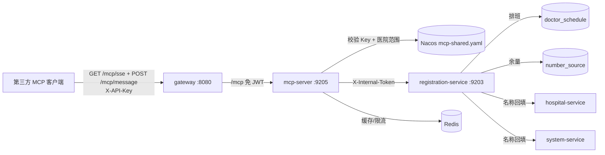

# 医院排班查询 MCP Server 设计

## 1. 背景与目标

对外提供一个 MCP Server，让第三方 AI 客户端按医院查询接下来一段时间的医生出诊与号源余量。

现状：

- 已有公开排班接口 `GET /api/registration/schedule/public/schedules`，但**不按医院过滤**、**无日期窗口与条数上限**、余量取排班冗余字段、无外部身份与限流，不能直接对外。
- 已有内部号源查询 `GET /inner/sources`，带医院约束且余量来自号源池，但要求 `departmentId`、单日期，且仅限服务间调用。
- 现有 AI 导诊工具 `queryNumberSources` 已验证“科室 + 日期 → 有余量号源”的查询模式，可借鉴。
- 项目没有 MCP 依赖，也没有 API Key 基础设施。

目标：

1. 第三方通过 SSE 接入，使用 API Key 认证；
2. Key 绑定医院范围，调用方无法越权查询其他医院；
3. 只读，返回真实余量，不暴露患者数据与内部号位；
4. 查询有日期窗口、条数和扫描上限，具备缓存、限流、审计日志与指标。

非目标（P1 或不做）：

- 预约、退号等写操作；
- 医生职称、实时叫号、排队进度；
- API Key 管理后台与数据库存储；
- OAuth 2.1 / 用户级授权；
- 复用或改造现有患者公开接口。

## 2. 已确认决策

| 决策 | 结论 |
|------|------|
| 接入形态 | 远程 SSE（`/mcp/sse` + `/mcp/message`），不做 stdio |
| 医院范围 | API Key 绑定医院 ID 白名单，可绑定单院或多院 |
| 能力范围 | v1 只读 |
| Key 存储 | Nacos `mcp-shared.yaml`，只存 SHA-256，不落库、不入库 |
| MCP 实现 | 新增独立模块 `services/mcp-server`，Spring AI MCP Server WebMVC |
| 数据来源 | registration-service 新增内部查询，余量按 `number_source.status=1` 统计 |

## 3. 总体架构



职责边界：

- **gateway**：只做路由与免 JWT 放行，不解析 API Key。
- **mcp-server**：MCP 协议、API Key 认证、医院范围校验、限流、缓存、日志与指标；不直连数据库。
- **registration-service**：新增内部只读查询，负责日期窗口/条数硬限制、余量统计与名称回填；不做外部认证。
- 现有 `/public/schedules` 保持不变，避免影响患者端。

## 4. 数据口径

### 4.1 余量

```
remainingCount = count(number_source where schedule_id = ? and status = 1)
```

- 不以 `doctor_schedule.registered_count` 作为余量，该字段仅作冗余统计。
- 未生成号源的排班余量为 0。
- 只返回 `doctor_schedule.status = 1` 的排班。

### 4.2 日期窗口

- 时区固定 `Asia/Shanghai`，日期计算显式使用该时区，不依赖 JVM 默认时区。
- `date_from` 默认今天；`date_to` 默认 `date_from + 6 天`。
- 必须满足 `date_from <= date_to`，且窗口最多 14 天（含首尾）。
- `date_from` 早于今天时按今天处理，不报错；生效起始日到 `date_to` 超过 14 天则报参数错误。

### 4.3 排序与截断

- 排序：日期升序 → 时段升序（上午在前）→ 排班 ID 升序。
- 数据库扫描上限 500 条；超过则 `truncated=true`。
- 医生姓名过滤后最多返回 100 条；超过同样 `truncated=true`。
- 医生姓名过滤在名称回填后内存匹配，忽略大小写与首尾空格。

## 5. 内部查询接口

### 5.1 接口

```
GET /inner/schedules/query
Header: X-Internal-Token
```

| 参数 | 必填 | 说明 |
|------|------|------|
| hospitalId | 是 | 医院 ID |
| dateFrom | 是 | `yyyy-MM-dd` |
| dateTo | 是 | `yyyy-MM-dd`，窗口 ≤ 14 天 |
| departmentId | 否 | 科室 ID |
| period | 否 | 1=上午，2=下午 |
| doctorName | 否 | 医生姓名，包含匹配 |

返回：

```json
{
  "code": 200,
  "data": {
    "items": [
      {
        "hospitalId": 1,
        "hospitalName": "示例医院",
        "departmentId": 10,
        "departmentName": "内科",
        "doctorUserId": 100,
        "doctorName": "张三",
        "scheduleDate": "2026-10-22",
        "period": 1,
        "periodText": "上午",
        "totalLimit": 20,
        "remainingCount": 7
      }
    ],
    "truncated": false
  }
}
```

### 5.2 实现落点

- `api` 模块新增 `DoctorScheduleInfoDTO`、`ScheduleQueryResultDTO`。
- `RegistrationClient` 新增 `querySchedules(...)`。
- `InnerRegistrationController` 新增查询端点，做参数校验与硬限制。
- `DoctorScheduleService` 新增 `queryForExternal(...)`：
  1. 按医院、日期、科室、时段查询启用排班，`LIMIT 501`；
  2. 批量统计各排班空闲号源数，覆盖 `ScheduleVO.remaining`；
  3. 复用现有 `enrich` 回填医院/科室/医生名称；
  4. 医生姓名过滤、截断并映射为内部 DTO。
- 内部查询不使用 `DataScope`，医院隔离由必填 `hospitalId` 与 MCP 层 Key 范围共同保证。

## 6. MCP 工具契约

Server 信息：

- name：`ai-hospital-schedule`
- 传输：SSE
- SSE 端点：`/mcp/sse`
- 消息端点：`/mcp/message`
- 仅启用 tool capability。

### 6.1 `list_hospitals`

无参数。返回当前 Key 可访问的医院：

```json
[{"hospitalId": 1, "hospitalName": "示例医院"}]
```

医院名称通过 `OrgClient.hospitals(allowedIds)` 获取；不存在的 ID 忽略并告警。

### 6.2 `query_doctor_schedules`

| 参数 | 类型 | 必填 | 说明 |
|------|------|------|------|
| hospital_id | integer | 单院 Key 可空 | 医院 ID；必须在 Key 白名单内 |
| date_from | string | 否 | `yyyy-MM-dd`，默认今天 |
| date_to | string | 否 | `yyyy-MM-dd`，默认 `date_from + 6` |
| department_id | integer | 否 | 科室 ID |
| doctor_name | string | 否 | 医生姓名，包含匹配 |
| period | integer | 否 | 1=上午，2=下午 |

返回：

```json
{
  "items": [
    {
      "hospitalId": 1,
      "hospitalName": "示例医院",
      "departmentId": 10,
      "departmentName": "内科",
      "doctorUserId": 100,
      "doctorName": "张三",
      "scheduleDate": "2026-10-22",
      "period": 1,
      "periodText": "上午",
      "totalLimit": 20,
      "remainingCount": 7
    }
  ],
  "truncated": false,
  "dateFrom": "2026-10-22",
  "dateTo": "2026-10-28"
}
```

错误以 `{"error": "..."}` 返回，不抛未处理异常：

| 场景 | 文案 |
|------|------|
| 未认证 | `未认证的调用方` |
| 多院 Key 未传 hospital_id | `请指定 hospital_id` |
| 医院越权 | `无权查询该医院` |
| 日期格式错误 | `日期格式应为 yyyy-MM-dd` |
| 查询区间已过期 | `查询区间已过期` |
| 窗口超限 | `查询窗口最多 14 天` |
| 下游不可用 | `排班查询服务暂时不可用，请稍后重试` |

### 6.3 不提供的工具

- 预约/退号：需要患者身份与二次确认，不能由匿名第三方代操作。
- 号位明细：暴露 `registration_id`，属于内部数据。
- 患者预约记录：PII。

## 7. API Key 与访问控制

### 7.1 Key 形态

- 明文格式：`mcp_<32 字节随机数的 hex>`，由调用方持有。
- 服务端只保存 `sha256(明文)` 的 hex。
- 请求头：`X-API-Key: mcp_...`，POST 与 SSE GET 的每次请求都必须携带。
- 比较使用 `MessageDigest.isEqual`，常量时间。
- 缺失、格式错误、未匹配、`enabled=false` 一律 401；配置为空时全部拒绝（fail closed）。
- 认证过滤器通过 `FilterRegistrationBean` 只注册到 `/mcp` 与 `/mcp/*`，同时覆盖 `/mcp/sse` 与 `/mcp/message`，不影响 Actuator 与健康检查。

### 7.2 配置

Nacos 新增 dataId `mcp-shared.yaml`，仅 mcp-server 导入：

```yaml
mcp:
  auth:
    keys:
      - consumer: demo-client
        key-sha256: "<sha256 hex>"
        hospital-ids: [1]
        rate-limit-per-minute: 60
        enabled: true
  cache:
    ttl-seconds: 45
```

- 仓库只提供 `scripts/nacos-mcp-shared.example.yaml`，不含真实 Key。
- 生成方式写入文档：`printf '%s' 'mcp_xxx' | sha256sum`。
- 配置使用 `@ConfigurationProperties`，由 Spring Cloud 配置重绑定在 Nacos 更新后生效；实例未刷新时重启 mcp-server，刷新失败保留旧值。

### 7.3 医院范围

- 单院 Key 未传 `hospital_id` 时自动使用唯一医院。
- 多院 Key 必须显式传 `hospital_id`。
- 入参医院不在白名单时统一返回“无权查询该医院”，不泄露其他医院信息。

### 7.4 限流

- Redisson 原子计数，键 `mcp:rate:{consumer}:{epochMinute}`，TTL 60 秒。
- 默认 60 次/分钟/Key，可按 Key 覆盖。
- 超限返回 HTTP 429，`{"error":"rate_limit_exceeded"}`。
- Redis 异常时限流放行并告警，避免缓存/限流故障拖垮只读查询。

### 7.5 缓存

- Redis 缓存 45 秒，键为 `mcp:schedule:{sha256(规范化查询条件)}`，避免姓名等自由文本直接进入键。
- 缓存值是 registration-service 返回的结果；缓存键包含全部查询条件，跨调用方共享是安全的（同一医院公开数据）。
- 只缓存成功结果；Redis 异常时直接查下游。
- 允许 45 秒内的余量延迟，文档明确说明。

### 7.6 调用方上下文传递

- Spring AI 1.0.9 的 WebMVC 传输只有 SSE；`McpServer.sync` 默认 `immediateExecution=false`，SYNC 工具在非请求线程执行，ThreadLocal 在工具方法内不可见。
- 认证过滤器把 `McpPrincipal` 写入 HTTP 请求属性 `McpPrincipalContext.REQUEST_ATTRIBUTE`。
- 自定义 `WebMvcSseServerTransportProvider` 的 `contextExtractor` 从 `ServerRequest.servletRequest()` 读取该属性，生成包含 `mcp.principal` 的 `McpTransportContext`。
- 工具方法声明末尾的 `ToolContext` 参数（Spring AI 不将其纳入工具 schema），通过 `McpToolUtils.getMcpExchange` 取 `McpSyncServerExchange`，再由 `transportContext()` 读取调用方；缺失时返回 `未认证的调用方`。

## 8. 模块与配置

### 8.1 新模块

```
services/mcp-server
  pom.xml
  src/main/java/com/mcp/
    McpServerApplication.java
    auth/McpAuthFilter.java
    auth/McpPrincipal.java
    auth/McpPrincipalContext.java
    auth/McpKeyHasher.java
    config/McpProperties.java
    config/McpToolConfig.java
    config/McpTransportConfig.java
    ratelimit/McpRateLimiter.java
    cache/ScheduleCache.java
    tool/ScheduleTools.java
    support/...
  src/main/resources/application.yml
```

- 端口 9205，应用名 `mcp-server`。
- 依赖：`common`、`api`、`spring-boot-starter-web`、Nacos discovery/config、OpenFeign、Redisson、`spring-ai-starter-mcp-server-webmvc`、Actuator、Lombok、Test。
- 启动类：`@EnableFeignClients("com.api.client")`，`scanBasePackages={"com.mcp","com.api"}`，以装配内部令牌拦截器。
- 不引入 `common-security`，避免把员工 JWT 体系带到外部入口。

### 8.2 application.yml 关键项

```yaml
server:
  port: 9205
spring:
  application:
    name: mcp-server
  cloud:
    nacos:
      discovery:
        server-addr: 127.0.0.1:8848
    openfeign:
      client:
        config:
          default:
            connect-timeout: 2000
            read-timeout: 5000
  config:
    import:
      - optional:nacos:common-shared.yaml?group=DEFAULT_GROUP
      - optional:nacos:mcp-shared.yaml?group=DEFAULT_GROUP
  ai:
    mcp:
      server:
        name: ai-hospital-schedule
        version: 1.0.0
        type: SYNC
        capabilities:
          resource: false
          prompt: false
          completion: false
        sse-endpoint: /mcp/sse
        sse-message-endpoint: /mcp/message
security:
  internal:
    token: ${INTERNAL_TOKEN:aidaima-internal-token-please-override}
```

### 8.3 网关

- 新增路由：`Path=/mcp,/mcp/**` → `lb://mcp-server`，不剥离前缀；该谓词同时覆盖 `/mcp/sse` 与 `/mcp/message`。
- 加入 `gateway.whitelist`，跳过 JWT。
- 不额外加网关限流，避免与 Key 级限流重复计数。

### 8.4 启动脚本与文档

- `scripts/start-services.bat/.sh` 增加 `mcp-server(9205)`。
- README 增加“MCP 排班查询”章节：Key 配置、连接地址、客户端示例、限制。
- `docs/design/architecture.md` 增加模块与调用链。
- 不修改前端。

## 9. 失败与降级

| 场景 | 行为 |
|------|------|
| Key 配置为空/全部禁用 | 401，日志 error |
| Redis 不可用 | 限流放行、缓存跳过，日志 warn |
| registration-service 超时 | 返回“排班查询服务暂时不可用”，日志 warn |
| 医院名称查询失败 | registration-service 现有 `enrich` 抛业务异常；MCP 返回下游不可用 |
| Nacos Key 刷新失败 | 保留旧配置，日志 error |
| 扫描超限 | `truncated=true`，正常返回 |

## 10. 可观测性

- 访问日志：`consumer`、tool、hospitalIds、查询条件、耗时、结果条数、结果状态；**不记录 API Key 与患者信息**。
- 指标：
  - `mcp_tool_calls_total{tool,outcome}`
  - `mcp_tool_duration_seconds{tool}`
  - `mcp_auth_failures_total{reason}`
  - `mcp_rate_limited_total{consumer}`
- 沿用现有 Micrometer / Prometheus 配置；不新增审计表。

## 11. 测试与验收

### 11.1 自动化测试

- registration-service：
  - 余量按空闲号源统计，忽略已占用；
  - 医院/日期/科室/时段过滤；
  - 医生姓名过滤（大小写、空格）；
  - 500 扫描与 100 返回截断；
  - 日期窗口、参数校验。
- mcp-server：
  - Key 缺失/错误/禁用/空配置 → 401；
  - 正确 Key → principal 与医院范围；
  - 单院默认、多院必填、越权拒绝；
  - 日期默认值与窗口校验；
  - 限流 429；
  - 工具返回结构与下游异常映射；
  - Feign 内部令牌拦截器装配（不真实外呼）。

### 11.2 手工验收

1. Nacos 创建 `mcp-shared.yaml`，写入一个 Key 与医院 ID；
2. 启动 stack 与 mcp-server；
3. 用 MCP Inspector 选择 SSE，连接 `http://localhost:8080/mcp/sse`，Header `X-API-Key`；
4. `tools/list` 返回 2 个工具；
5. `list_hospitals` 只返回 Key 绑定医院；
6. `query_doctor_schedules` 返回的余量与 `number_source.status=1` 数量一致；
7. 错误 Key → 401；跨院 → 无权查询；15 天窗口 → 参数错误；
8. 直接用员工/患者 JWT 访问 `/mcp/sse` 不生效（只认 API Key）。

### 11.3 验收标准

1. 现有患者端、管理端接口行为不变；
2. 外部只能通过 `/mcp/sse` 与 `/mcp/message` 访问，`/inner/**`、`/api/**` 仍受原有保护；
3. 任何工具都不能返回 Key 未绑定医院的数据；
4. 查询结果有明确窗口、条数和截断标记；
5. 不新增数据库表，不接触患者 PII；
6. 单测覆盖认证、越权、窗口、余量、截断与限流。

## 12. 风险与缓解

| 风险 | 影响 | 缓解 |
|------|------|------|
| Spring AI 1.0.9 MCP starter 兼容问题 | 模块无法启动 | 先用最小 demo 验证；不可行时退到官方 MCP Java SDK |
| 余量与真实挂号瞬时不一致 | 第三方展示偏差 | 45 秒缓存；余量以号源池为准；文档说明 |
| Key 泄露 | 越权查询 | Key 绑定医院、可按 Key 限流、Nacos 快速轮换、日志不落 Key |
| SSE 传输无标准 API Key 语义 | 客户端接入差异 | 文档给出 Header 配置；P1 评估 OAuth |
| SYNC 工具在非请求线程执行 | ThreadLocal 取不到调用方 | 通过 `McpTransportContext` + `ToolContext` 传递 Principal |
| 医生姓名过滤内存匹配 | 大结果集性能 | 先限制 500 条扫描，再过滤 100 条 |
| 外部轮询压力 | 下游负载 | Key 级限流 + 45 秒缓存 + 行数上限 |

## 13. 实施阶段

| 阶段 | 内容 |
|------|------|
| Phase 1 | api DTO、registration-service 内部查询与单测 |
| Phase 2 | mcp-server 模块骨架、Key 认证、两个工具、单测 |
| Phase 3 | 缓存、限流、日志/指标、网关路由、Nacos 示例、启动脚本 |
| Phase 4 | README/架构文档、MCP Inspector 手工验收清单 |

## 14. 待确认项

无。接入形态、医院范围、只读边界已确认。
